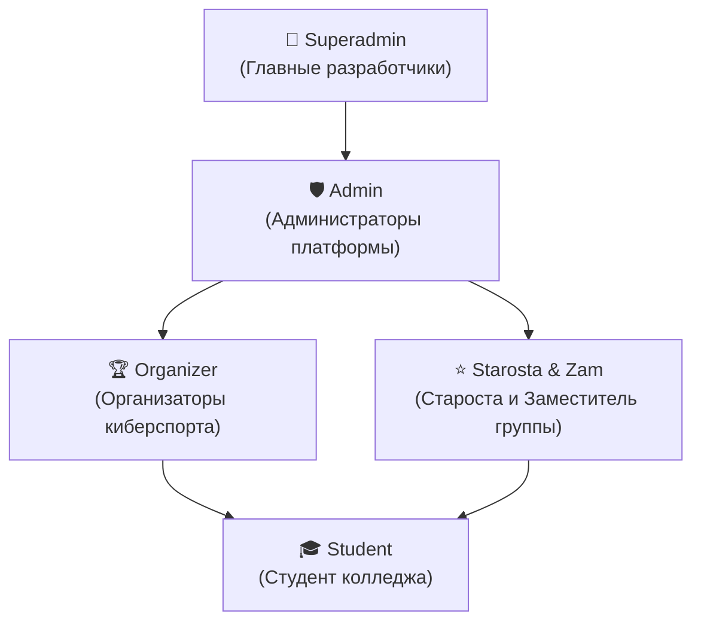

# 🎓 AITU Schedule Bot · v3.0
### Интеллектуальная цифровая экосистема расписания колледжа AITU
#### Telegram Bot • Telegram Mini App (Web App) • REST API • Киберспортивные турниры

[✨ Возможности](#-ключевые-возможности) •
[📱 Mini App](#-telegram-mini-app-web-app) •
[🔔 График звонков](#-график-звонков-14-курсы) •
[📱 Команды](#-команды-бота) •
[👥 Ролевая модель](#-ролевая-модель-доступа-rbac) •
[🛡 Политика развёртывания](#-политика-развёртывания) •
[🔒 Лицензия](#-лицензия-и-права-доступа)

---

> [!IMPORTANT]
> **Проприетарное программное обеспечение. Развёртывание строго ограничено.**  
> Развёртывание, запуск и хостинг данного программного комплекса **категорически запрещены всем лицам, кроме создателей проекта или лиц, получивших прямое письменное разрешение от создателей**. Продукт функционирует как централизованный официальный сервис эксклюзивно для студентов, преподавателей и администрации колледжа AITU.

---

## 📖 О проекте

**AITU Schedule Bot v3.0** — современная цифровая экосистема для автоматизации учебного процесса колледжа AITU. Проект объединяет удобный Telegram-бот, интерактивное веб-приложение **Telegram Mini App**, REST API и киберспортивную турнирную платформу.

### Основные компоненты системы:
1. **Telegram-бот для студентов и старост** — персональные расписания для всех 57 академических групп 1–4 курсов, умные звонки, напоминания за 10 минут, пятиминутки и оперативные замены.
2. **Telegram Mini App (Web App)** на React 19 + Vite + Tailwind CSS v4 — интерактивный нативный веб-интерфейс прямо внутри мессенджера с календарём, переключателем дней и тёмной темой.
3. **Киберспортивный турнирный модуль** — турнирные сетки (Brackets), профили команд, статистика встреч и онлайн-регистрация.
4. **Асинхронный REST API** — бэкенд на базе `aiohttp`, объединяющий веб-интерфейс и базу данных.
5. **Авто-синхронизация с порталом СДО** — регулярный мониторинг и автоматическое наложение замен на расписание занятий.

---

## ✨ Ключевые возможности

### 📱 Telegram Mini App (Web App)
- **Запуск в 1 клик**: доступен через нативную кнопку `📱 Mini App` в левом нижнем углу чата.
- **Интерактивная сетка**: просмотр занятий по дням и неделям, авто-определение чётности (**Числитель / Знаменатель**).
- **Синхронизация с темой Telegram**: адаптивный дизайн, повторяющий оформление приложения пользователя (Dark / Light mode).
- **TelegramOnlyGuard**: приватность доступа — просмотр оптимизирован для открытия внутри Telegram. При попытке перехода из обычного браузера выводится защитный экран с QR-кодом для входа через бота.
- **Свободный просмотр**: возможность быстро посмотреть расписание любого отделения или группы без сброса личных настроек.

### 🏆 Киберспортивный турнирный модуль (HLTV Hub)
- **Продвинутая панель организатора турниров**: создание новых чемпионатов (на 4, 8, 16 слотов), выбор киберспортивных аватарок и кубков (Золотой Кубок, Чемпионский Щит, Phoenix Trophy, Cyber Major), детальная настройка призового фонда (1-е, 2-е, 3-е места, MVP).
- **Расширенная анкета регистрации**: название команды, клан-тег, выбор киберспортивного логотипа-пресета (Щит, Клинки, Феникс, Огонь, Дракон, Молния, Снайпер, Корона) или прямой ссылки, учебная группа команды, контакты капитана (Telegram, Faceit ник / ELO, группа).
- **Детальный ростер участников**: для каждого игрока (Капитан + 4 основных + 1 запасной) фиксируются игровой никнейм, Faceit ник / ссылка на ELO, учебная группа колледжа (например, 9ПО-43к) и позиция/роль (IGL, Снайпер, Рифлер, Опорник, Саппорт).
- **Интерактивная модерация заявок и умный посев (Seeding)**: подтверждение и отклонение заявок, ручное или автоматическое назначение посева `#1`..`#8`, детальный просмотр анкет.
- **Генерация турнирных сеток**: формирование олимпийской сетки Single Elimination с правильной рассадкой по посеву (#1 vs #8, #4 vs #5, #2 vs #7, #3 vs #6) и поддержкой фиксации счёта и продвижения победителей.
- **Общий лидерборд игроков (Top Fraggers)**: рейтинг участников по общему числу фрагов (киллам), показателю K/D и проценту хедшотов (HS%), визуальный подиум топ-3.
- **Интерактивная турнирная сетка (Brackets)** с отображением матчей плей-офф, карт, счёта и официальных скриншотов протоколов табло (Scoreboard).
- **История турниров колледжа**: верифицированный архив `AITU PRO LEAGUE SEASON 1` с протоколами всех 6 матчей на FastCup.

### 🏛 Мультигрупповая архитектура (57 групп, 1–4 курсы)
- **Полная база всех отделений**: охватывает более 1000 семестровых пар для групп 1, 2, 3 и 4 курсов.
- **Интеллектуальная нормализация**: корректная обработка названий групп независимо от регистра и раскладки клавиатуры (кириллица / латиница).
- **Пошаговый мастер курса**: при первом входе `/start` или по команде `/group` бот предлагает выбрать курс и выводит список актуальных групп.
- **Привязка студенческих бесед**: команда `/bind <Группа>` синхронизирует Telegram-чат с расписанием группы.

### 🔔 Дифференцированный график звонков
- **Раздельное время обедов по курсам:**
  - **1 курс:** Обед после 1-й пары (`10:35 — 11:10`, 35 минут).
  - **2 курс:** Обед **внутри 2-й пары** (`11:30 — 12:00`, 30 минут) между первой и второй половинами пары (`10:45 — 12:45`).
  - **3 и 4 курсы:** Обед после 2-й пары (`12:20 — 12:55`, 35 минут).
- **Внутрипарные пятиминутки**: автоматические оповещения о перерывах внутри учебных пар (`45м + 5м + 45м`).
- **Интерактивный справочник `/bells`**: удобная инлайн-клавиатура для переключения звонков любого курса.

### ⚠️ Замены и оперативные изменения
- **Автоматическое наложение на расписание**:
  - Отменённые пары перечёркиваются: `<s>1. Предмет</s> [❌ ОТМЕНЕНА: Причина]`.
  - Заменённые пары выделяются: `[⚠️ ЗАМЕНА: Предмет / Кабинет]`.
- Учёт изменений в статусе текущей пары `/now` и в утренних рассылках.
- Раздел `/zameny` для просмотра опубликованных изменений на ближайшие дни.

### 💬 Умный инлайн-режим (`@aituraspisaniebot`)
- **Контекстная привязка к группе**: вызов бота в любом чате Telegram (`@aituraspisaniebot`) автоматически загружает расписание академической группы вызывающего студента из базы данных.
- **Поиск по любой группе или преподавателю**: `@aituraspisaniebot 9ПО-21`, `@aituraspisaniebot Иванов`, `@aituraspisaniebot 304`.
- **Быстрые карточки**: мгновенная отправка карточек на сегодня, завтра, текущий статус занятия, расписание звонков с учётом обеда по курсу, недельный график и актуальные замены.
- **Изоляция данных**: индивидуальное кэширование (`is_personal=True`), исключающее смешивание групп между пользователями.

### ⚙️ Тонкая настройка оповещений в беседах (`/chat_settings`)
- Индивидуальное управление системными сообщениями для каждой привязанной беседы через инлайн-тумблеры:
  - 🔔 Звонки на пятиминутки внутри пар;
  - ⏰ Колокольчик за 10 минут до начала пары;
  - 🌅 Утренняя рассылка в 08:00 по будням;
  - 🌙 Полночное расписание в 00:00;
  - ⚠️ Экстренные оповещения об официальных заменах и отменах пар.
- Управление доступно администраторам чата, старосте привязанной группы и администраторам платформы.

### 📚 Студенческие сервисы и полезные материалы
- **Библиотека конспектов (`/lectures`)**: встроенный онлайн-ридер с навигацией по страницам.
- **Шаблон титульного листа (`/maket`)**: официальный утверждённый бланк `.docx` для ЛР и ПЗ.
- **Поиск кабинетов (`/room <номер>`)**: быстрый поиск занятий по номеру аудитории.
- **Экспорт в календарь (`/calendar`)**: добавление расписания в формате `.ics` в Apple / Google Calendar.
- **Преподаватели (`/teachers`)**: список преподавателей и их кафедр/кабинетов.

---

## 🔔 График звонков (1–4 курсы)

### 2 курс (Обед внутри 2-й пары — 30 минут)
| Пара | Время | Внутренняя структура пары |
|:---:|:---:|:---|
| **1** | **09:00 — 10:35** | `09:00–09:45` • ☕️ 5 мин перерыв • `09:50–10:35` |
| **2** | **10:45 — 12:45** | `10:45–11:30` • 🥪 **ОБЕД (11:30–12:00, 30 мин)** • `12:00–12:45` |
| **3** | **12:55 — 14:30** | `12:55–13:40` • ☕️ 5 мин перерыв • `13:45–14:30` |
| **4** | **14:40 — 16:15** | `14:40–15:25` • ☕️ 5 мин перерыв • `15:30–16:15` |

### 3 и 4 курсы (Обед после 2-й пары — 35 минут)
| Пара | Время | Внутренняя структура пары |
|:---:|:---:|:---|
| **1** | **09:00 — 10:35** | `09:00–09:45` • ☕️ 5 мин перерыв • `09:50–10:35` |
| **2** | **10:45 — 12:20** | `10:45–11:30` • ☕️ 5 мин перерыв • `11:35–12:20` |
| **🥪 Обед** | **12:20 — 12:55** | **Большая перемена (35 минут)** |
| **3** | **12:55 — 14:30** | `12:55–13:40` • ☕️ 5 мин перерыв • `13:45–14:30` |
| **4** | **14:40 — 16:15** | `14:40–15:25` • ☕️ 5 мин перерыв • `15:30–16:15` |

### 1 курс (Обед после 1-й пары — 35 минут)
| Пара | Время | Внутренняя структура пары |
|:---:|:---:|:---|
| **1** | **09:00 — 10:35** | `09:00–09:45` • ☕️ 5 мин перерыв • `09:50–10:35` |
| **🥪 Обед** | **10:35 — 11:10** | **Большая перемена (35 минут)** |
| **2** | **11:10 — 12:45** | `11:10–11:55` • ☕️ 5 мин перерыв • `12:00–12:45` |
| **3** | **12:55 — 14:30** | `12:55–13:40` • ☕️ 5 мин перерыв • `13:45–14:30` |
| **4** | **14:40 — 16:15** | `14:40–15:25` • ☕️ 5 мин перерыв • `15:30–16:15` |

---

## 📱 Команды бота

### Для студентов
- `/start` — Запуск бота, главное меню и выбор группы.
- `/today` — Расписание занятий на сегодня.
- `/tomorrow` — Расписание на завтра.
- `/now` — Live-статус текущей пары, шкала прогресса и оставшееся время.
- `/week` — Расписание на текущую учебную неделю.
- `/group` — Смена академической группы (выбор курса 1..4).
- `/bells` — График звонков с переключением курсов.
- `/zameny` — Просмотр активных замен на ближайшие даты.
- `/settings` — Персональные настройки студента в личных сообщениях.
- `/chat_settings` — Гибкие настройки системных оповещений беседы (пятиминутки, 10 мин, утро, полночь, замены).
- `/lectures` — Библиотека конспектов лекций.
- `/room <номер>` — Поиск занятий по аудитории (например: `/room 605`).
- `/teachers` — Список преподавателей группы.
- `/calendar` — Экспорт расписания в формат `.ics`.
- `/moodle` — Образовательный портал СДО.
- `/maket` — Скачать титульный лист (`.docx`).
- `/id` — Узнать свой числовой Telegram ID.

### Для старост групп (`/starosta`)
- 🚪 **Смена аудитории** — оперативное обновление номера кабинета для своей группы.
- ⚠️ **Добавить замену** — мастер добавления замен и переносов.
- ❌ **Отменить пару** — отмена занятия с указанием причины.
- 🗑 **Удалить замену** — откат изменений в расписании.
- 🔒 **Защита выборов**: если староста или зам уже назначены, переизбирать или снимать руководство разрешено **только действующим старосте/заму или администраторам**. При смене академической группы руководящие роли сбрасываются.

---

## 👥 Ролевая модель доступа (RBAC)

| Роль | Зона ответственности | Назначение |
|---|---|---|
| **👑 Superadmin** | Полный доступ: инфраструктура, база данных, системные параметры. | Указывается в конфигурационном файле `.env`. |
| **🛡 Admin** | Управление расписаниями групп, назначения старост, рассылки. | Назначается администрацией колледжа. |
| **🏆 Organizer** | Организация CS2 турниров, модерация заявок команд, назначение призов, логотипов и посева, генерация олимпийских сеток и ведение протоколов матчей. | Назначается администрацией колледжа или через startapp `role_organizer`. |
| **⭐️ Starosta / Zam** | Управление заменами и кабинетами **своей группы** (до 2 человек на группу). Защищено от перехвата обычными студентами. | Назначается через старостат группы или админом. |
| **🎓 Student** | Расписание, Mini App, персональные уведомления, конспекты. | Доступно всем авторизованным студентам. |

---

## 🛡 Политика развёртывания

> [!CAUTION]
> ### ⛔️ Запрет на независимое развёртывание
> **Развёртывание, хостинг, установка и запуск данного программного обеспечения на любых серверах, VPS, облачных платформах или локальных машинах категорически запрещены всем лицам и организациям, кроме оригинальных создателей (авторов) проекта либо лиц, получивших прямое письменное разрешение от создателей.**
> 
> Проект не является открытым шаблоном для самостоятельного развёртывания (Self-Hosted). Экосистема функционирует как централизованный официальный сервис колледжа AITU, администрируемый исключительно разработчиками. Любая попытка несанкционированного клонирования и запуска экземпляров сервиса является нарушением условий лицензии и авторских прав.

### 🏗 Архитектура и стек технологий (Справочная информация)
Данный раздел приведён исключительно для ознакомления со структурой компонентов платформы:
- **Ядро Telegram-бота:** Python 3.11+, Aiogram 3.13 (полностью асинхронный бот-фреймворк, FSM-машины состояний, MemoryStorage).
- **База данных:** SQLite 3 в режиме Write-Ahead Logging (WAL) + SQLAlchemy 2.0 ORM с поддержкой пула соединений.
- **Web App (Mini App):** React 19, TypeScript, Vite, Tailwind CSS v4, Lucide Icons, Telegram WebApp SDK.
- **REST API:** Асинхронный сервер на `aiohttp` с маршрутизацией эндпоинтов расписания, групп и турниров.
- **Веб-сервер и обратный прокси:** Caddy Server с автоматическим управлением TLS-сертификатами (HTTPS) и защитой эндпоинтов.
- **Супервизор и надёжность:** Службы systemd, отдельный независимый Watchdog-контроллер и фоновый мониторинг состояния сервисов.

---

## 🔒 Лицензия и права доступа

**Proprietary & Confidential Software License**

© 2026 Разработчики AITU Schedule Bot. Все права защищены.

- **🚫 Запрет развёртывания:** Развёртывание, запуск, публикация и хостинг любых компонентов данного продукта (Telegram-бот, WebApp Mini App, REST API, база данных) третьими лицами **категорически запрещены**. Исключительное право на развёртывание и эксплуатацию сервиса принадлежит только оригинальным авторам (создателям) проекта или лицам, получившим их прямое письменное разрешение.
- **🔐 Закрытый доступ:** Исходный код, архитектура, графические ассеты, база данных расписания и сопутствующая документация являются интеллектуальной собственностью. Запрещено несанкционированное копирование, распространение, создание производных версий или форков.
- **🎓 Доступ для пользователей:** Студентам, старостам и преподавателям колледжа AITU предоставляется доступ исключительно в режиме конечного использования через официальный бот в Telegram и официальный Telegram Mini App.

