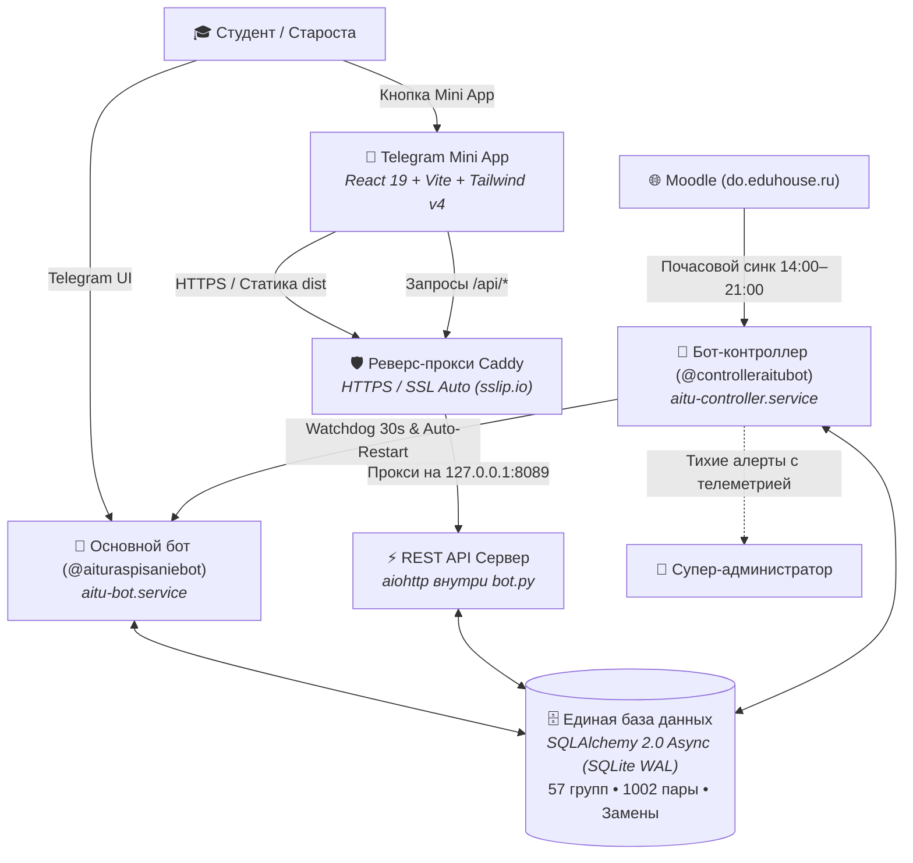
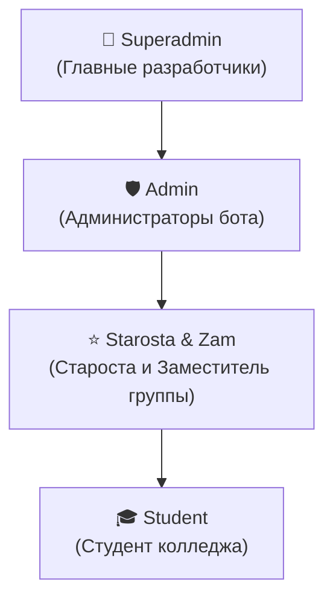

<div align="center">

# 🎓 AITU Schedule Bot · v3.0
### Интеллектуальная экосистема расписания колледжа AITU
#### Telegram Bot • Telegram Mini App (Web App) • REST API • Киберспортивные турниры • Moodle Sync

[](https://github.com/wxrrry/aitu-schedule-bot/releases)
[](https://www.python.org/)
[](https://docs.aiogram.dev/)
[](https://react.dev/)
[](https://vitejs.dev/)
[](https://tailwindcss.com/)
[](https://www.sqlalchemy.org/)
[](#)

[✨ Возможности](#-ключевые-возможности-v30) •
[📱 Mini App](#-telegram-mini-app-web-app) •
[🏛 Архитектура](#-архитектура-экосистемы) •
[🔔 График звонков](#-дифференцированный-график-звонков-14-курсы) •
[📱 Команды](#-команды-и-навигация) •
[👥 Ролевая модель](#-ролевая-модель-доступа-rbac) •
[🚀 Развёртывание](#-развёртывание-на-сервере-vps) •
[📝 Changelog](#-changelog-v300)

</div>

---

## 📖 О проекте

**AITU Schedule Bot v3.0** — это масштабное обновление экосистемы академического расписания для студентов и преподавателей колледжа AITU. Проект эволюционировал из простого Telegram-бота в полноценный программный комплекс, включающий:

1. **Telegram-бот для студентов и старост** (`@aituraspisaniebot`) с поддержкой всех 57 академических групп 1–4 курсов, дифференцированными звонками, напоминаниями за 10 минут, пятиминутками и заменами.
2. **Telegram Mini App (Web App)** на React 19 + Tailwind CSS v4 — интерактивный нативный веб-интерфейс прямо внутри Telegram с просмотром расписания по дням/неделям, сменой групп и киберспортивным модулем.
3. **Высокопроизводительный REST API сервер** на базе `aiohttp`, объединяющий веб-клиент и бота с общей базой данных.
4. **Киберспортивный турнирный модуль**: турнирные сетки (Brackets), расписание матчей, HLTV-профили команд и регистрация участников.
5. **Выделенный бот-контроллер и супервизор** (`@controlleraitubot`) с фоновым Watchdog-мониторингом (30 сек), тихими информативными алертами и автоматическим парсером замен с портала Moodle (`do.eduhouse.ru`).

---

## 🏛 Архитектура экосистемы

Система построена на принципах микросервисного разделения обязанностей, высокой отказоустойчивости и минимального потребления ресурсов сервера:



---

## ✨ Ключевые возможности v3.0

### 📱 Telegram Mini App (Web App)
- **Нативный запуск внутри Telegram**: доступен в левом нижнем углу чата через кнопку `📱 Mini App` (`MenuButtonWebApp`).
- **Сетка расписания**: интерактивный выбор дня недели, индикатор текущей чётности (**Числитель / Знаменатель**), карточки занятий с кабинетами, преподавателями и временем.
- **Telegram Theme Matching**: автоматическая адаптация интерфейса под цветовую схему Telegram клиента (Dark / Light mode).
- **TelegramOnlyGuard**: безопасность доступа — при открытии страницы в обычном браузере отображается интерактивный экран с QR-кодом для перехода в Telegram-бота.
- **Быстрая смена группы**: мгновенный просмотр расписания любой другой группы колледжа без изменения личных настроек бота.

### 🏆 Киберспортивный турнирный модуль (Tournaments & Teams)
- **Интерактивная турнирная сетка (Brackets)**: визуализация плей-офф матчей в реальном времени.
- **HLTV-style профили команд**: составы игроков, логотипы, статистика побед и поражений.
- **Регистрация участников**: подача заявок команд на турниры колледжа прямо через веб-интерфейс.
- **Синхронизация через REST API**: моментальное сохранение турниров, команд и результатов в общую базу данных.

### ⚡️ Встроенный REST API сервер (`aiohttp`)
- Запущен внутри основного процесса на порту `8089` и защищён реверс-прокси Caddy.
- **Эндпоинты API:**
  - `GET /api/health` — проверка работоспособности сервиса.
  - `GET /api/stats` — системная статистика пользователей, групп и пар.
  - `GET /api/groups` — полный список всех академических групп по курсам.
  - `GET /api/schedule?group=9ПО-43к` — расписание конкретной группы на неделю.
  - `GET /api/tournaments` & `POST /api/tournaments` — управление турнирами и сетками.
  - `GET /api/profile` & `POST /api/profile` — получение и сохранение профиля студента.
- Встроенная поддержка CORS для безопасности междоменных запросов.

### 🏛 Колледж-масштабная база групп (57 групп, 1–4 курсы)
- **Полная база всех отделений**: ИТ, дизайн, информационная безопасность, сетевое администрирование, технические специальности (`9ПО-43к`, `9ИС-21`, `9ВР-11`, `9КС-31`, `9СК-41` и др.).
- **Каноническая нормализация названий (`canonical_group_name`)**: интеллектуальное сопоставление визуально похожих букв кириллицы и латиницы (`9PO-43k` ➔ `9ПО-43к`), исключающее ошибки поиска и дублирования записей.
- **FSM-мастер первого входа**: при первом запуске `/start` или команде `/group` бот предлагает удобный выбор курса (1..4) и отображает точный список групп соответствующего курса.
- **Привязка бесед (`/bind`)**: возможность привязать Telegram-чат группы к конкретному расписанию.

### 🔔 Дифференцированный график звонков (1–4 курсы)
- **Раздельное время обеденных перерывов:**
  - **1 курс:** Обед после 3-й пары (`14:05 — 14:40`), завершение занятий в `18:00`.
  - **2, 3, 4 курсы:** Обед после 2-й пары (`12:20 — 12:55`), завершение занятий в `16:15`.
- **Внутрипарные пятиминутки**: автоматическое оповещение о перерывах внутри пар (`45 мин + 5 мин отдых + 45 мин`).
- **Интерактивный справочник звонков `/bells`**: быстрое переключение курсов на инлайн-клавиатуре.

### ⚠️ Замены и интеграция с Moodle (`do.eduhouse.ru`)
- **Автоматический сбор замен**: планировщик проверяет сайт `do.eduhouse.ru` каждый час с 14:00 до 21:00 (период публикации приказов).
- **Парсинг документов `.docx`**: автоматическое распознавание таблиц замен, выделение затронутых групп, номеров пар, преподавателей и кабинетов.
- **Наглядное отображение**:
  - Отменённые пары перечёркиваются: `<s>1. Предмет</s> [❌ ОТМЕНЕНА: Причина]`.
  - Заменённые пары подсвечиваются: `[⚠️ ЗАМЕНА: Предмет / Кабинет]`.
  - Замены автоматически интегрируются в `/now`, `/today`, `/tomorrow`, `/week` и утренние рассылки.

### 🛡 Выделенный супервизор и тихий Watchdog
- Все критические административные операции (перезапуск процессов, чтение системных логов, мониторинг) вынесены в отдельный бот-контроллер.
- **Watchdog (30 сек)**: автоматически детектирует зависание или падение основного бота и перезапускает его через systemd.
- **Тихие информативные уведомления**: все сервисные сообщения отправляются без звука (`disable_notification=True`) и содержат системную телеметрию (CPU, RAM, Swap, Disk, Uptime, PID, вырезки из журналов ошибок).

---

## 🔔 Дифференцированный график звонков (1–4 курсы)

### 2, 3 и 4 курсы (Обед после 2-й пары)
| Пара | Время | Структура занятия (45м + 5м + 45м) |
|:---:|:---:|:---|
| **1** | **09:00 — 10:35** | `09:00–09:45` • ☕️ 5 мин перерыв • `09:50–10:35` |
| **2** | **10:45 — 12:20** | `10:45–11:30` • ☕️ 5 мин перерыв • `11:35–12:20` |
| **🥪 Обед** | **12:20 — 12:55** | **Большая перемена (35 минут)** |
| **3** | **12:55 — 14:30** | `12:55–13:40` • ☕️ 5 мин перерыв • `13:45–14:30` |
| **4** | **14:40 — 16:15** | `14:40–15:25` • ☕️ 5 мин перерыв • `15:30–16:15` |

### 1 курс (Обед после 3-й пары)
| Пара | Время | Структура занятия (45м + 5м + 45м) |
|:---:|:---:|:---|
| **1** | **09:00 — 10:35** | `09:00–09:45` • ☕️ 5 мин перерыв • `09:50–10:35` |
| **2** | **10:45 — 12:20** | `10:45–11:30` • ☕️ 5 мин перерыв • `11:35–12:20` |
| **3** | **12:30 — 14:05** | `12:30–13:15` • ☕️ 5 мин перерыв • `13:20–14:05` |
| **🥪 Обед** | **14:05 — 14:40** | **Большая перемена (35 минут)** |
| **4** | **14:40 — 16:15** | `14:40–15:25` • ☕️ 5 мин перерыв • `15:30–16:15` |
| **5** | **16:25 — 18:00** | `16:25–17:10` • ☕️ 5 мин перерыв • `17:15–18:00` |

---

## 📱 Команды и навигация

### Основные команды студента
- `/start` — Главное меню, приветствие и выбор академической группы.
- `/today` — Расписание занятий на сегодня с учётом чётности и актуальных замен.
- `/tomorrow` — Расписание на завтра.
- `/now` — Live-мониторинг текущей пары, прогресс-бар и таймер до перемены/обеда.
- `/week` — Расписание на всю текущую учебную неделю.
- `/group` — Быстрая смена группы через пошаговый мастер курсов (1..4).
- `/bells` — Интерактивное расписание звонков с переключателем курсов.
- `/zameny` — Просмотр активных замен и отмен пар на ближайшие даты.
- `/settings` — Настройки уведомлений (утреннее напоминание, колокольчик за 10 мин, пятиминутки).
- `/lectures` — Библиотека конспектов лекций с онлайн-читалкой.
- `/teachers` — Список преподавателей группы и их аудиторий.
- `/room <номер>` — Поиск занятий по номеру аудитории (например `/room 605`).
- `/calendar` — Экспорт расписания в формат `.ics` для Apple/Google Calendar.
- `/moodle` — Быстрые ссылки на СДО Moodle (`do.eduhouse.ru`).
- `/maket` — Скачать утверждённый шаблон титульного листа (`.docx`) для ЛР/ПЗ.
- `/id` — Узнать свой числовой Telegram ID в один клик.

### Панель старосты группы (`/starosta`)
- 🚪 **Сменить аудиторию пары** — оперативное обновление номера кабинета для своей группы.
- ⚠️ **Добавить замену** — пошаговый мастер внесения изменений в расписание.
- ❌ **Отменить пару** — отмена занятия с указанием причины (болезнь, олимпиада, окно).
- 🗑 **Удалить замену** — откат изменений в исходное состояние.

### Команды администратора
- `/bind <группа>` — Привязать Telegram-беседу к расписанию группы.
- `/unbind` — Отвязать Telegram-беседу от расписания.
- `/refresh` — Обновить кэш и клавиатуры интерфейса.

---

## 👥 Ролевая модель доступа (RBAC)



| Роль | Привилегии и зона ответственности | Назначение |
|---|---|---|
| **👑 Superadmin** | Полный контроль: управление ботом-контроллером, перезапуск процессов, чтение системных логов, обновление Git, БД. | Переменная `ADMIN_IDS` / `SUPERADMIN_IDS` в `.env`. |
| **🛡 Admin** | Управление расписаниями групп, массовые рассылки, просмотр аналитики, назначение старост. | Назначается через панель управления. |
| **⭐️ Starosta / Zam** | Управление заменами, перемещением пар и аудиториями **своей группы** (до 2 человек на группу). | Назначается студентами в `/settings` или админом. |
| **🎓 Student** | Просмотр расписания, колокольчики, конспекты, Mini App, выбор группы. | Присваивается автоматически при старте. |

---

## 🚀 Развёртывание на сервере (VPS)

### 1. Автоматическая установка (Ubuntu / Debian)
Проект содержит скрипт автоматической установки, который настраивает окружение, зависимости, службу systemd и скрипт обновления:

```bash
curl -sSL https://raw.githubusercontent.com/wxrrry/aitu-schedule-bot/main/deploy/setup_vps.sh | sudo bash
```

### 2. Ручная установка и настройка

```bash
# Клонирование репозитория
git clone https://github.com/wxrrry/aitu-schedule-bot.git /opt/aitu-schedule-bot
cd /opt/aitu-schedule-bot

# Создание виртуального окружения
python3 -m venv venv
./venv/bin/pip install --upgrade pip
./venv/bin/pip install -r requirements.txt

# Настройка переменных окружения
cp .env.example .env
nano .env

# Сборка статики Telegram Mini App
cd webapp
npm install
npm run build
cd ..
```

### 3. Пример файла `.env`
```env
BOT_TOKEN=8839919135:AAxxxxxxxxxxxxxxxxxxxxxxxxxxxx
CHAT_ID=-1002135486048
TIMEZONE=Europe/Moscow
ANCHOR_DATE=2026-10-12
ANCHOR_PARITY=chislitel
ADMIN_ID=792569339
ADMIN_IDS=792569339,1019252177
WEBAPP_URL=https://72-4-67-12.sslip.io
PORT=8089
```

### 4. Настройка Caddy (Веб-сервер и SSL)
В файле `/etc/caddy/Caddyfile`:

```caddy
72-4-67-12.sslip.io {
    encode zstd gzip

    handle /api/* {
        reverse_proxy 127.0.0.1:8089
    }

    handle /health {
        reverse_proxy 127.0.0.1:8089
    }

    handle {
        root * /opt/aitu-schedule-bot/webapp/dist
        try_files {path} /index.html
        file_server
    }
}
```

### 5. Управление службой Systemd
```bash
# Перезапуск бота
sudo systemctl restart aitu-bot

# Просмотр статуса
sudo systemctl status aitu-bot

# Просмотр онлайн-логов
sudo journalctl -u aitu-bot -f

# Быстрое обновление из Git
/opt/aitu-schedule-bot/deploy/update.sh
```

---

## 📝 Changelog: v3.0.0

### 🚀 Major Features & Enhancements
- **Telegram Mini App (Web App):** Полная интеграция современного SPA на React 19 + Tailwind CSS v4 с нативной кнопкой в Telegram, динамическим переключением групп, сеткой расписания и защитой `TelegramOnlyGuard`.
- **REST API Subsystem:** Встроенный асинхронный сервер на `aiohttp` (порт 8089), обслуживающий эндпоинты расписания, групп, турниров и профилей пользователей.
- **Киберспортивный турнирный модуль:** Турнирные сетки (Brackets), профили команд, расписание матчей и регистрация участников.
- **Полная база 57 групп колледжа:** Охват 1–4 курсов с канонической нормализацией названий (`canonical_group_name`, `get_group_variants`) и решением проблем регистра и латиницы/кириллицы.
- **Дифференцированные звонки по курсам:** Раздельное расписание обедов и пятиминуток для 1-го курса и 2–4 курсов с интерактивным переключателем `/bells`.
- **Авто-синхронизация с Moodle:** Парсер сайта `do.eduhouse.ru` (почасовой поиск с 14:00 до 21:00) и автоматическое наложение замен из `.docx`.
- **Supervisor & Watchdog:** Изоляция административных операций в `@controlleraitubot` с 30-секундным Watchdog-мониторингом и тихими информативными алертами (`disable_notification=True`).
- **Unified Database:** Переход на чистую асинхронную архитектуру SQLAlchemy 2.0 с поддержкой SQLite WAL и PostgreSQL.

---

## 📄 Лицензия

Проект разработан для студентов и преподавателей колледжа AITU. Распространяется под лицензией MIT.
