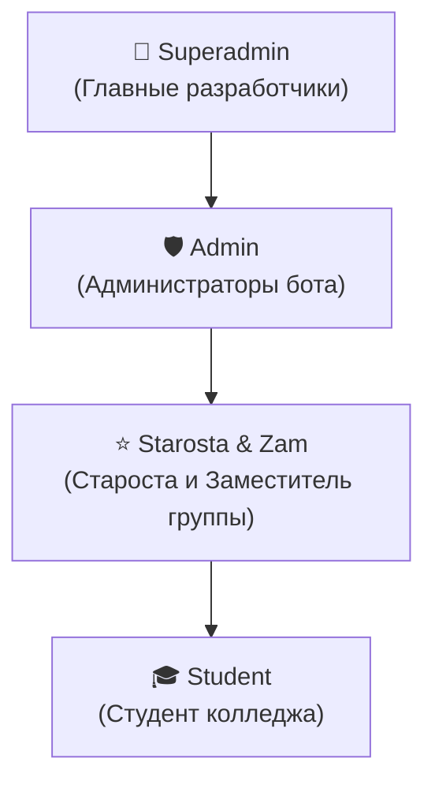

<div align="center">

# 🎓 AITU Schedule Bot · v2.0
### Умная экосистема академического расписания для студентов колледжа AITU

[](https://github.com/wxrrry/aitu-schedule-bot/releases)
[](https://www.python.org/)
[](https://docs.aiogram.dev/)
[](https://www.sqlalchemy.org/)
[](https://render.com)
[](#)

[✨ Возможности](#-ключевые-возможности) •
[👥 Ролевая модель](#-ролевая-модель-доступа-rbac) •
[🔔 График звонков](#-график-звонков-и-пятиминуток) •
[📱 Команды и меню](#-команды-и-навигация) •
[⚙️ Админка и староста](#-панели-управления) •
[🚀 Развёртывание](#-развёртывание-и-хостинг)

</div>

---

## 📖 О проекте

**AITU Schedule Bot** — это многофункциональный Telegram-бот нового поколения для студентов колледжа. Бот решает проблему постоянного отслеживания изменений в учебном процессе: автоматически определяет чётность недели (**Числитель / Знаменатель**), поддерживает **любые академические группы**, разграничивает расписание звонков для разных курсов, изолирует замены и отмены, а также предоставляет студентам персональные напоминания за 10 минут до занятий и доступ к конспектам лекций.

---

## ✨ Ключевые возможности

### 🏛 Мультигрупповая архитектура (College-wide)
- **Поддержка любых групп колледжа** (`9ПО-43к`, `9ПО-11`, `11ИС-21`, `9ПО-21`, `9ПО-31`, `9ПО-32` и др.).
- **Персональный выбор группы**: студенты настраивают свою группу в `/settings` в 1 клик.
- **Привязка бесед и чатов**: команда `/bind <Группа>` привязывает Telegram-группу к расписанию конкретной студенческой группы, обеспечивая автоматическую публикацию актуальных сводок.
- **Изоляция данных**: расписания, отмены и замены изолированы между группами.

### 🗄 Асинхронная БД (SQLite + SQLAlchemy 2.0)
- Высокопроизводительное хранилище на `aiosqlite` и `SQLAlchemy 2.0`.
- Полноценные реляционные модели: `User`, `Group`, `Lesson`, `Replacement`, `ChatBinding`, `BroadcastLog`.
- Автоматическая система миграций и инициализации схемы при запуске.

### ⚠️ Управление заменами и отменами пар в реальном времени
- **Мгновенная подсветка в расписании**:
  - Отменённые пары перечёркиваются: `<s>1. Предмет</s>` с красной плашкой `[❌ ПАРА ОТМЕНЕНА: Причина]`.
  - Заменённые пары отображаются с деталями: `[⚠️ ЗАМЕНА: Кабинет / Преподаватель]`.
- **Умная интеграция**: отмены автоматически учитываются в `/now` (сообщает об окне) и в утреннем оповещении 08:00 (автоматически переносит время первой пары).
- **Интерактивный кабинет старосты**: управление заменами без необходимости ввода сложных команд.

### 🔔 Дифференцированный график звонков (1–4 курсы)
- Автоматическое определение курса по шифру группы:
  - **1 курс:** Обед после 3-й пары (`13:40 — 14:15`), занятия до `17:05`.
  - **2, 3, 4 курсы:** Обед после 2-й пары (`12:20 — 12:55`), занятия до `16:15`.
- **Внутрипарные пятиминутки**: внутри каждой пары предусмотрен 5-минутный перерыв (`45 мин + 5 мин отдых + 45 мин`). Бот уведомляет об этом студентов во время занятий.
- Интерактивный справочник звонков `/bells` с мгновенным переключением курсов.

### ⚡️ Live-мониторинг текущей пары (`/now`)
- Визуальный прогресс-бар: `[▓▓▓▓▓▓░░░░] 60%`.
- Точный таймер обратного отсчёта до конца пары, перемены или обеда.
- Карточка следующей пары (кабинет, преподаватель, предмет).
- Кнопка `🔄 Обновить статус`.

### ⏰ Умные рассылки и личный колокольчик
- **00:00 (MSK)** — полночная детальная сводка на наступающий учебный день.
- **08:00 (MSK)** — утреннее напоминание о начале учёбы и первой паре.
- **Колокольчик за 10 минут (`/remind`)**: персональная подписка каждого студента на личные push-уведомления перед каждой парой (`08:50`, `10:35`, `12:45`, `14:30`).

### 💬 Inline-режим (`@username_bot` в любом чате)
- Мгновенная отправка карточек прямо из строки ввода:
  - `📅 Сегодня`, `🔜 Завтра`, `⚡️ Сейчас`, `🗓 Вся неделя`
  - `🔔 Звонки`, `⚠️ Замены`, `📚 Лекции`, `📁 СДО и Материалы`
  - Быстрый поиск по номеру кабинета (например `@bot 304`) или дню недели.

### 📚 База знаний, конспекты и шаблоны
- Встроенная библиотека конспектов лекций с удобным постраничным ридером (`◀️ Назад`, `Вперёд ▶️`) и возможностью скачивания файлов `.md`.
- Интеграция с порталом СДО Moodle (`/moodle`).
- Мгновенная выдача утверждённого шаблона титульного листа `.docx` для ЛР и ПЗ (`/maket`).

### 🛡 Защита от спама и надёжность
- `ThrottlingMiddleware`: интеллектуальный антифлуд для кнопок и команд.
- `Broadcaster`: безопасная отправка массовых сообщений с обработкой лимитов Telegram (`TelegramRetryAfter`) и автоочисткой пользователей, заблокировавших бота (`TelegramForbiddenError`).

---

## 👥 Ролевая модель доступа (RBAC)

В системе реализовано 4 уровня привилегий:



| Роль | Права и возможности | Как назначается |
|---|---|---|
| **👑 Superadmin** | Полный доступ: назначение админов, БД, аварийное восстановление, тесты рассылок, глобальный бродкаст. | Хардкод в `config.py` / `permissions.py` (IDs: `1019252177`, `792569339`). |
| **🛡 Admin** | Управление расписанием всех групп, интерактивная рассылка, просмотр статистики, назначение старост. | Назначается через `/admin` супер-администратором. |
| **⭐️ Starosta / Zam** | Управление заменами, перемещением пар и аудиториями **своей группы**. До 2 человек на группу. | Студентами группы в `/settings` либо администратором в `/admin`. |
| **🎓 Student** | Просмотр расписания, колокольчики, конспекты, выбор группы. | По умолчанию для каждого пользователя. |

---

## 🔔 График звонков и пятиминуток

### 2, 3 и 4 курсы (Обед после 2-й пары)
| Пара | Время | Внутренняя структура (45м + 5м + 45м) |
|:---:|:---:|:---|
| **1** | **09:00 — 10:35** | `09:00–09:45` • ☕️ 5 мин перерыв • `09:50–10:35` |
| **2** | **10:45 — 12:20** | `10:45–11:30` • ☕️ 5 мин перерыв • `11:35–12:20` |
| **🥪 Обед** | **12:20 — 12:55** | **Большая перемена (35 минут)** |
| **3** | **12:55 — 14:30** | `12:55–13:40` • ☕️ 5 мин перерыв • `13:45–14:30` |
| **4** | **14:40 — 16:15** | `14:40–15:25` • ☕️ 5 мин перерыв • `15:30–16:15` |

### 1 курс (Обед после 3-й пары)
| Пара | Время | Внутренняя структура (45м + 5м + 45м) |
|:---:|:---:|:---|
| **1** | **09:00 — 10:35** | `09:00–09:45` • ☕️ 5 мин перерыв • `09:50–10:35` |
| **2** | **10:45 — 12:20** | `10:45–11:30` • ☕️ 5 мин перерыв • `11:35–12:20` |
| **3** | **12:30 — 14:05** | `12:30–13:15` • ☕️ 5 мин перерыв • `13:20–14:05` |
| **🥪 Обед** | **14:05 — 14:40** | **Большая перемена (35 минут)** |
| **4** | **14:40 — 16:15** | `14:40–15:25` • ☕️ 5 мин перерыв • `15:30–16:15` |
| **5** | **16:25 — 18:00** | `16:25–17:10` • ☕️ 5 мин перерыв • `17:15–18:00` |

---

## 📱 Команды и навигация

### Основные команды студента
- `/start` — Главное меню и выбор академической группы.
- `/today` — Расписание занятий на сегодня.
- `/tomorrow` — Расписание занятий на завтра.
- `/now` — Live-статус: какая пара идёт сейчас, прогресс-бар и оставшиеся минуты.
- `/week` — Расписание на всю текущую учебную неделю.
- `/nextweek` — Расписание на следующую неделю.
- `/bells` — Интерактивное расписание звонков с переключателем 1–4 курсов.
- `/zameny` — Просмотр активных замен и отмен пар.
- `/remind` — Включение/отключение персонального напоминания за 10 минут.
- `/settings` — Выбор учебной группы и назначение старосты/заместителя.
- `/lecture` — Каталог конспектов лекций с онлайн-читалкой.
- `/teachers` — Список преподавателей и их аудиторий.
- `/room <номер>` — Поиск пар по аудитории (например `/room 404`).
- `/calendar` — Экспорт расписания в формат `.ics` для Apple/Google Calendar.
- `/moodle` — Ссылки на СДО Moodle и образовательные ресурсы.
- `/maket` — Скачать утверждённый шаблон титульного листа (`.docx`).

### Команды старосты группы
- `/starosta` — Интерактивная панель старосты (inline-управление заменами и отменами).
- `/zamena <дата> <пара> отмена` — Быстрая отмена пары (например `/zamena 19.10 2 отмена`).
- `/zamena <дата> <пара> <предмет, каб. XXX>` — Добавление переноса/замены.
- `/zamena del <дата> <пара>` — Удаление замены.

### Команды администратора
- `/admin` — Главная панель управления администратора.
- `/bind <группа>` — Привязать Telegram-беседу к расписанию группы.
- `/unbind` — Отвязать Telegram-беседу.

---

## ⚙️ Панели управления

### 1. Кабинет старосты (`/starosta`)
Полностью интуитивный интерфейс с кнопками:
- `➕ Добавить отмену пары` (выбор даты ➔ номера пары ➔ выбор готовой причины: *"Болезнь преподавателя"*, *"Командировка"*, *"Пары не будет"* или свой текст).
- `✏️ Добавить замену/перенос` (удобный пошаговый мастер с клавиатурой).
- `🚪 Сменить кабинет пары` (быстрое изменение номера аудитории для группы).
- `🗑 Удалить замену` (кнопки со списком активных замен в один клик).

### 2. Панель администратора (`/admin`)
- **👥 Роли и старосты**: список всех супер-админов, админов и назначенных старост по группам с кнопками быстрого назначения по `@username` или `ID`.
- **📢 Рассылка сообщений**: пошаговый мастер рассылок с предпросмотром HTML-разметки и таргетингом аудитории:
  - *👥 Всем студентам колледжа*
  - *🎓 Только определённой группе*
  - *💬 Во все подключенные беседы*
- **🧪 Тестирование рассылок**: мгновенная отправка тестовых уведомлений (полночь, 08:00, пятиминутка, 10 минут) прямо в чат администратора для проверки форматирования.
- **📊 База данных и статистика**: просмотр общего числа пользователей, групп, активных привязок бесед и экспорт логов.

---

## 🚀 Развёртывание и хостинг

### Вариант 1: Render.com (Бесплатно, Web Service)
1. Создайте репозиторий на GitHub и привяжите его к **[render.com](https://render.com)**.
2. Создайте **New Web Service**, укажите ветку `main`.
3. Добавьте переменные окружения:
   - `BOT_TOKEN` — токен от `@BotFather`
   - `ADMIN_IDS` — ID главных администраторов через запятую (`1019252177,792569339`)
   - `TIMEZONE` — часовой пояс (например `Europe/Moscow`)
   - `CHAT_ID` — ID дефолтной группы (опционально)
4. В проект встроен **автоматический Keep-Alive пингер** (`/health`), предотвращающий переход бесплатного инстанса Render в спящий режим.

### Вариант 2: Собственный VPS-сервер (Systemd / Docker)
Подробная инструкция по развёртыванию на личном сервере и подключению супервизора-контроллера доступна в [`docs/VPS_AND_CONTROLLER.md`](file:///docs/VPS_AND_CONTROLLER.md).

```bash
# Клонирование и установка
git clone https://github.com/wxrrry/aitu-schedule-bot.git
cd aitu-schedule-bot

python3 -m venv .venv
source .venv/bin/activate
pip install -r requirements.txt

# Настройка переменных
cp .env.example .env
nano .env

# Запуск бота
python bot.py
```

### Запуск через Docker Compose:
```bash
docker compose -f deploy/docker-compose.yml up -d --build
```

---

## 🧪 Тестирование

Проект покрыт автоматизированным набором регрессионных тестов:
```bash
python scratch/test_suite.py
```
Тест проверяет:
- Инициализацию и миграции SQLite;
- Привязку пользователей и групп;
- Ролевые права (RBAC);
- Изоляцию замен между группами;
- Генерацию расписания и HTML-форматирование;
- Разделение звонков и обеденных интервалов 1–4 курсов;
- Привязку бесед.

---

## 📄 Лицензия

Проект разработан для студентов колледжа AITU. Распространяется под лицензией MIT.
