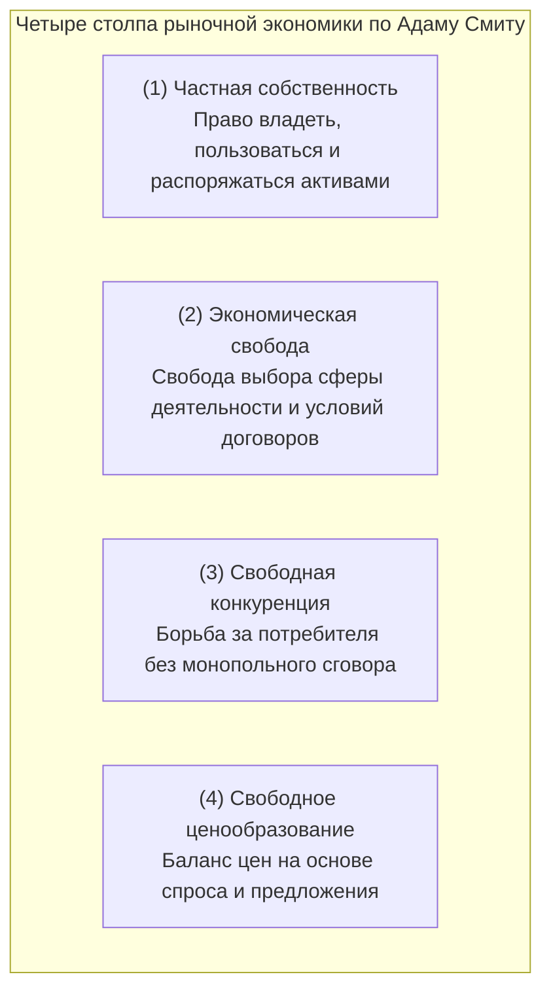
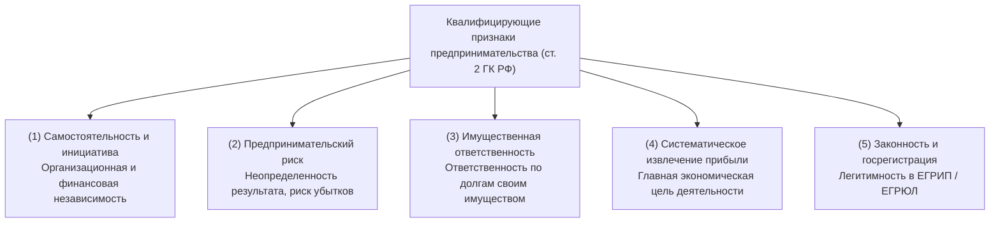
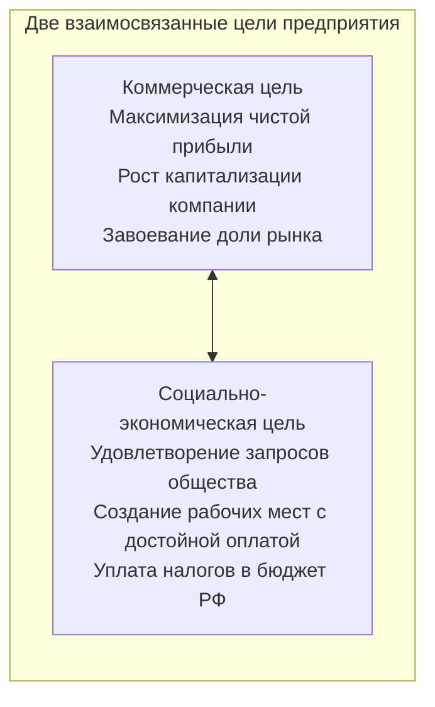
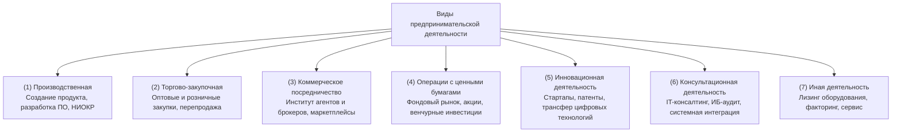
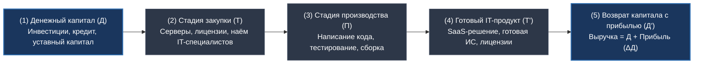

# 📚 Экономика отрасли: Организация в системе рыночных отношений (16.10.2026)
**Преподаватель:** Петрова Е.А. · **Пара:** Пт-2 (каб. 711)

### 16.10.26 — Организация в системе рыночных отношений. Сущность предпринимательства
**Предмет:** [[📚 Экономика отрасли]] · **Преподаватель:** Петрова Е.А. · **Пара:** Пт-2 · **Ауд:** 711  
**Тема по КТП:** Тема 1. Предприятие (организация) в системе рыночной экономики. Сущность и признаки предпринимательской деятельности  
Связи: [[📖 4 курс 1 сем]] · [[📖 Глоссарий 4 курс#💼 Экономика отрасли|Глоссарий]] · [[✅ Сессия 4-1]] · [[📅 16.10 Пятница]]

> [!abstract] Резюме лекции (TL;DR)
> - **Рыночная экономика** — экономическая система, основанная на принципах свободного предпринимательства, многообразия форм собственности, рыночного ценообразования и конкуренции при ограниченном вмешательстве государства.
> - **Адам Смит (1776 г., «Исследование о природе и причинах богатства народов»)** заложил фундаментальные принципы рыночных отношений: концепция **«невидимой руки рынка»** (стремление индивида к личной выгоде объективно способствует общественному благу через механизм конкуренции).
> - **Предпринимательство (ст. 2 ГК РФ)** — самостоятельная, осуществляемая на свой риск деятельность, направленная на систематическое получение прибыли от пользования имуществом, продажи товаров, выполнения работ или оказания услуг лицами, зарегистрированными в установленном законом порядке.
> - **5 ключевых признаков бизнеса:** 1) самостоятельность и инициатива; 2) предпринимательский риск; 3) имущественная ответственность; 4) цель — систематическая прибыль; 5) законность и госрегистрация.
> - **Классификация видов деятельности:** производственная, торгово-закупочная, коммерческое посредничество (институт агентов и брокеров), операции с ценными бумагами (финансовая), инновационная деятельность, консультационная (консалтинг) и иная деятельность.
> - **Предприятие (организация, ст. 48 ГК РФ)** — самостоятельный хозяйствующий субъект со статусом юридического лица, обладающий обособленным имуществом и производящий товары, работы или услуги.
> - **Специфика экономики IT-отрасли:** нематериальный характер активов (ПО, базы данных, IP), до 70–80% расходов в структуре себестоимости приходится на ФОТ разработчиков, близкие к нулю предельные издержки тиражирования (marginal cost $\approx 0$), государственные преференции (налог на прибыль 0–5%, взносы 7.6% по ст. 427 НК РФ).
> - **Формы ведения бизнеса в РФ:** Самозанятые (НПД), ИП (полная ответственность имуществом), ООО (ограниченная ответственность долями УК), АО (акционерный капитал).

---

#### 📌 1. Понятийный аппарат и законодательная база

Базовые понятия дисциплины закреплены в высших нормативных правовых актах Российской Федерации:

| Термин | Юридическое / Экономическое определение | Нормативный источник |
|---|---|---|
| **Предпринимательская деятельность** | Самостоятельная, осуществляемая на свой риск деятельность, направленная на систематическое получение прибыли от пользования имуществом, продажи товаров, выполнения работ или оказания услуг лицами, зарегистрированными в этом качестве в установленном законом порядке. | Ч. 1 ст. 2 Гражданского кодекса РФ (ГК РФ) |
| **Свобода экономической деятельности** | Каждый имеет право на свободное использование своих способностей и имущества для предпринимательской и иной не запрещенной законом экономической деятельности. | Ч. 1 ст. 34 Конституции РФ |
| **Юридическое лицо (организация)** | Организация, которая имеет обособленное имущество и отвечает им по своим обязательствам, может от своего имени приобретать и осуществлять гражданские права и нести обязанности, быть истцом и ответчиком в суде. | Ч. 1 ст. 48 ГК РФ |
| **Прибыль** | Положительная разница между совокупными доходами предприятия (выручкой) и совокупными расходами (издержками) на производство и реализацию продукции за отчетный период ($Прибыль = Выручка - Издержки$). | Экономическая теория / Налоговый кодекс РФ (гл. 25 НК РФ) |
| **Рынок** | Совокупность экономических отношений между производителями и потребителями по поводу купли-продажи товаров и услуг на основе спроса, предложения и конкуренции. | Теория рыночной экономики |

---

#### 🏛️ 2. Условия рыночной экономики и концепция Адама Смита

Современная модель рыночной экономики базируется на классической теории шотландского экономиста и философа **Адама Смита** (1723–1790), изложенной в его фундаментальном труде *«Исследование о природе и причинах богатства народов» (1776)*.

##### Ключевые идеи Адама Смита:
1. **«Экономический человек» (*Homo Economicus*):** поведением каждого участника хозяйственной жизни движет рациональный личный эгоистический интерес — стремление улучшить свое материальное положение и максимизировать личный доход.
2. **Концепция «Невидимой руки рынка» (*The Invisible Hand*):**
   > *«Не от благожелательности мясника, пивовара или булочника ожидаем мы получить свой обед, а от соблюдения ими своих собственных интересов. Мы обращаемся не к их гуманности, а к их эгоизму… Преследуя свои собственные интересы, человек часто более действенным образом служит интересам общества, чем тогда, когда сознательно стремится делать это».*
3. **Механизм рыночного саморегулирования:**
   - Если спрос на IT-решения превышает предложение, цены растут, норма прибыли увеличивается, капитал устремляется в IT-отрасль, и предложение подтягивается.
   - Если рынок перенасыщен, цены падают, неэффективные компании разоряются, восстанавливая рыночный баланс.
4. **Роль государства (принцип «государства — ночного сторожа»):**
   - Государство не должно вмешиваться в ценообразование или указывать компаниям, что производить.
   - Функции государства ограничены тремя задачами: защита национальных границ (армия), правопорядок и исполнение контрактов (суд и полиция), поддержка общественной инфраструктуры (дороги, образование).

---

#### 💼 3. Сущность и ключевые признаки предпринимательской деятельности

Предпринимательство является ключевым драйвером рыночной экономики. На основе **ст. 2 ГК РФ** выделяются **пять квалифицирующих признаков предпринимательства**:

1. **Самостоятельность и инициативность:**
   - Предприниматель сам решает, какой программный продукт разрабатывать, по какой цене продавать, кого нанимать и как распределять доходы. Он не подчиняется вышестоящему плановому органу.
2. **Рисковый характер (предпринимательский риск):**
   - Деятельность осуществляется в условиях неопределенности: рыночная конъюнктура может измениться, конкуренты выпустят аналогичный софт дешевле, заказчик задержит оплату. Риск банкротства целиком лежит на предпринимателе.
3. **Имущественная ответственность:**
   - В отличие от наемного работника (который рискует максимум месячным окладом или увольнением), предприниматель отвечает по обязательствам перед банками, поставщиками и клиентами своим имуществом.
4. **Систематическое получение прибыли:**
   - Целью бизнеса является не разовый случайный заработок, а регулярный финансовый результат. Единоразовая продажа личного ноутбука на Avito предпринимательством не является, а регулярная перепродажа закупленной техники — является.
5. **Легитимность и государственная регистрация:**
   - Деятельность признается законной только после внесения записи в Единый государственный реестр индивидуальных предпринимателей (**ЕГРИП**) или юридических лиц (**ЕГРЮЛ**). Незаконное предпринимательство без регистрации преследуется по **ст. 14.1 КоАП РФ** и **ст. 171 УК РФ**.

---

#### 🏢 4. Предприятие (организация) как первичное звено экономики

- **Организация (предприятие)** — это обособленная специализированная единица, в которой происходит соединение факторов производства (труда, капитала, земли, информации) для выпуска готовой продукции, выполнения работ или оказания услуг.
- **Основные черты юридического лица (ст. 48 ГК РФ):**
  - **Организационное единство:** наличие структуры управления, устава, штатного расписания и регламентов.
  - **Имущественная обособленность:** наличие собственного баланса, расчетного счета в банке, принадлежащих организации серверов, оборудования и нематериальных активов.
  - **Самостоятельная ответственность:** отвечает по долгам своими активами.
  - **Выступление в гражданском обороте от своего имени:** право заключать SLA-договоры, приобретать лицензии, подавать иски в арбитражный суд.

---

#### 🗺️ 5. Классификация видов предпринимательской деятельности

Предпринимательская деятельность разнообразна по своему характеру, объектам и формам хозяйствования. В современной экономике она включает в себя **производственную**, **торгово-закупочную**, **коммерческое посредничество**, **операции с ценными бумагами**, **инновационную**, **консультационную** и **иную деятельность**:

| Вид деятельности | Экономическая сущность и содержание операций | Примеры в сфере IT и телеком-отрасли |
|---|---|---|
| **1. Производственная** | Создание материальных благ или нематериальных продуктов (ПО, базы данных), выполнение научно-исследовательских или строительно-монтажных работ. Наиболее капиталоемкий и ответственный сектор экономики. | Разработка программных платформ (SaaS, On-Premises, мобильные ОС), производство серверного и сетевого оборудования, выпуск микроэлектроники. |
| **2. Торгово-закупочная** | Закупка материальных ценностей, оборудования и прав у производителей оптовыми партиями с последующей реализацией потребителям. Прибыль образуется за счет торговой наценки (маржи). | Дистрибуция коробочных версий ПО, оптовые поставки серверных стоек, розничные сети и интернет-магазины цифровой и компьютерной техники. |
| **3. Коммерческое посредничество** | Деятельность по установлению хозяйственных связей между производителями и потребителями без прямого производства продукта посредником. Опирается на **институт агентов и брокеров**. | Платформы-маркетплейсы (App Store, VK Play), брокеры вычислительных мощностей ЦОД, агентские сети по дистрибуции лицензий корпоративного ПО. |
| **4. Операции с ценными бумагами (финансовая)** | Купля-продажа акций, облигаций, опционов, векселей, управление инвестиционными портфелями и привлечение долгового/долевого капитала на фондовом рынке. | Выход IT-компаний на биржу (IPO / SPO: Positive Technologies, ГК «Астра», «Яндекс»), деятельность венчурных инвестиционных фондов. |
| **5. Инновационная** | Разработка, освоение и коммерциализация принципиально новых продуктов, передовых технологий, патентование изобретений и проведение прикладных НИОКР (R&D). | Создание и дообучение больших языковых моделей (LLM), разработка систем квантовой криптографии, блокчейн-протоколов, новых архитектур процессоров. |
| **6. Консультационная (консалтинг)** | Предоставление профессиональных независимых экспертных услуг по анализу бизнес-процессов, выбору архитектуры, оптимизации затрат и внедрению решений. | IT-консалтинг (внедрение 1С:ERP, SAP), аудит информационной безопасности (пентесты, аудит по требованиям ФСТЭК/ФСБ), юридический IT-консалтинг. |
| **7. Иная деятельность** | Вспомогательные и гибридные формы экономической активности, обслуживающие производственные процессы и товарооборот. | Лизинг серверных мощностей и IT-оборудования, факторинг (финансирование под уступку денежного требования по госконтрактам), гарантийное ТО. |

##### 🤝 Институт коммерческого посредничества: агенты и брокеры
Коммерческое посредничество является ключевым механизмом снижения трансакционных издержек в рыночной экономике:
1. **Институт агентов (агентские отношения, ст. 1005 ГК РФ):**
   - **Агент** совершает по поручению другой стороны (**принципала**) юридические и иные действия за вознаграждение.
   - Две схемы работы:
     - *От своего имени, но за счет принципала* (агент сам приобретает права и обязанности по сделке с третьим лицом, например, дистрибьютор, продающий софт от своего лица).
     - *От имени и за счет принципала* (права и обязанности возникают напрямую у принципала, например, торговый представитель).
   - В IT-индустрии институт агентов масштабно представлен партнерскими и франчайзинговыми сетями (например, сеть партнеров «1С:Франчайзинг»).
2. **Институт брокеров:**
   - **Брокер** — независимое лицо или организация, выступающая посредником при заключении сделок между покупателем и продавцом. Брокер не становится собственником товара и не несет прямых обязательств по исполнению контракта.
   - Доход брокера составляет **брокерская комиссия** (процент от суммы совершенной сделки).
   - В классической экономике брокеры действуют на товарных, сырьевых, валютных и фондовых биржах; в IT-экономике институт брокеров трансформировался в **брокеров облачных сервисов (Cloud Brokers)**, брокеров больших данных (**Data Brokers**) и цифровые маркетплейсы.

---

#### 💻 6. Специфика экономики предприятий в IT-отрасли

Экономика IT-предприятий кардинально отличается от классических промышленных производств (металлургии, машиностроения, строительства):

| Параметр | Традиционное промышленное предприятие | Предприятие IT-отрасли (Software Development) |
|---|---|---|
| **Главный фактор производства** | Основные производственные фонды (станки, цеха, сырье, тяжелое оборудование). | Человеческий капитал, интеллектуальная собственность (код, архитектура, патенты). |
| **Структура себестоимости** | Высокая доля материальных затрат (сырье, материалы, амортизация оборудования — до 60–80%). | Доминирование **Фонда оплаты труда (ФОТ)** и страховых взносов программистов (до 70–85% себестоимости). |
| **Предельные издержки тиражирования (*Marginal Cost*)** | Высокие: выпуск каждого следующего автомобиля требует новой порции металла, резины и рабочего времени. | **Стремятся к нулю ($\approx 0$):** тиражирование копии ПО или доступ нового пользователя к SaaS-сервису не стоит компании практически ничего. |
| **Масштабируемость бизнеса** | Ограничена физическими мощностями заводов, логистикой и сырьем. | Почти мгновенная глобальная масштабируемость через облачные сервисы (Cloud Computing). |
| **Налоговые преференции в РФ (2024–2026 гг.)** | Стандартный налог на прибыль 20–25%, страховые взносы 30%. | **Льготы для аккредитованных IT-компаний (ст. 427 НК РФ):** пониженные страховые взносы **7.6%** (вместо 30%), льготный налог на прибыль. |

---

#### ⚖️ 7. Организационно-правовые формы ведения бизнеса в РФ

Перед запуском бизнеса гражданин выбирает оптимальную организационно-правовую форму:

| Критерий | Самозанятость (НПД) | Индивидуальный предприниматель (ИП) | Общество с ограниченной ответственностью (ООО) |
|---|---|---|---|
| **Регулирование** | Федеральный закон № 422-ФЗ | ГК РФ, гл. 3 | Федеральный закон № 14-ФЗ «Об ООО» |
| **Статус** | Физическое лицо | Физическое лицо со статусом предпринимателя | Юридическое лицо |
| **Имущественная ответственность** | Отвечает **всем личным имуществом** гражданина | Отвечает **всем личным имуществом** (квартиры, машины, счета, кроме ст. 446 ГПК) | Отвечает **только имуществом компании** (в пределах уставного капитала от 10 000 руб.)* |
| **Число участников** | Строго 1 человек | Строго 1 человек | От 1 до 50 участников (партнеров) |
| **Налоговая нагрузка** | **4%** (с доходов от физлиц), **6%** (с юрлиц). Без отчетов и деклараций. | УСН («Доходы» 6% или «Доходы минус расходы» 15%), патент (ПСН) | УСН (6% или 15%) или ОСНО (налог на прибыль + НДС 20%) |
| **Лимит годового дохода** | До **2.4 млн рублей** в год | До 200–450 млн руб. (по критериям УСН) | Не ограничен (при ОСНО) |
| **Привлечение наемных работников** | **Запрещено** иметь работников по трудовому договору | Разрешено (до 100–130 чел. на УСН) | Без ограничений |
| **Для чего идеально в IT** | Фриланс: верстка сайтов, дизайн, частные консультации | Небольшие веб-студии, сервисные центры, аутстаффинг | Продуктовые IT-компании, стартапы с инвесторами, работа с госзаказом |

> [!warning] Субсидиарная ответственность в ООО
> Правило об ограничении ответственности ООО только уставным капиталом перестает действовать в случае банкротства по вине учредителей или директора: по закону о банкротстве (№ 127-ФЗ) на них возлагается **субсидиарная ответственность по всем долгам фирмы всем личным имуществом**.

---

#### 🔄 8. Механизм кругооборота капитала предприятия

Деятельность любого предприятия представляет собой непрерывный процесс движения капитала по формуле Карла Маркса:  
$$Д \longrightarrow Т (СП, РС) \dots П \dots Т' \longrightarrow Д'$$

- **Стадия 1 (Авансирование):** денежные средства ($Д$) направляются на приобретение факторов производства ($Т$): покупку оборудования (серверов, ПК), оплату облачных мощностей и авансирование труда программистов ($РС$ — рабочая сила).
- **Стадия 2 (Производство):** непосредственный процесс создания ценности ($П$) — проектирование архитектуры, кодинг, интеграция баз данных, проведение тестирования.
- **Стадия 3 (Реализация):** готовый цифровой продукт ($Т'$) выводится на рынок и продается клиентам. В результате предприятие получает выручку ($Д'$), где:
  $$Д' = Д + \Delta Д$$
  где $\Delta Д$ — полученная **чистая прибыль (прибавочная стоимость)**.

---
