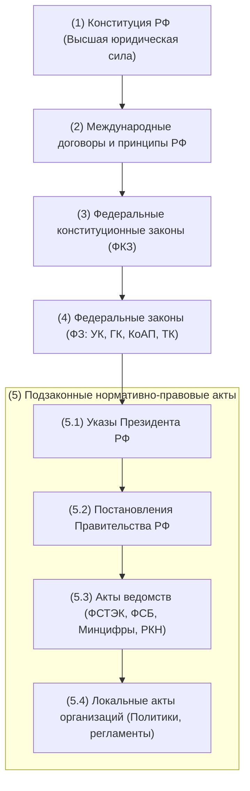
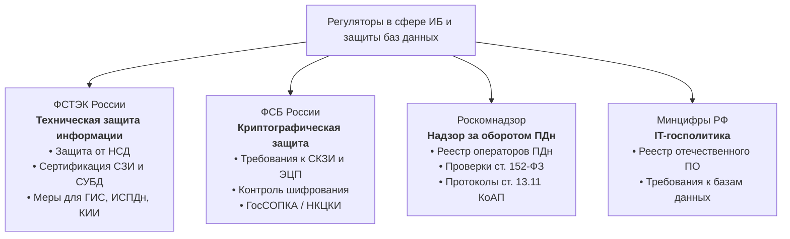
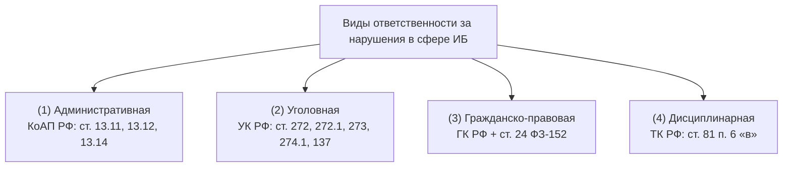

# 📚 МДК 07.02: Защита и сохранность информации БД (15.10.2026)
**Преподаватель:** Щербакова М.А. · **Пара:** Чт-3 (каб. 304)

### 15.10.26 — Защита и сохранность информации баз данных. Законодательство РФ в области ИБ
**Предмет:** [[📚 МДК 07.02 Сертификация ИС]] · **Преподаватель:** Щербакова М.А. · **Пара:** Чт-3 · **Ауд:** 304  
**Тема по КТП:** Тема 2.1. Защита и сохранность информации баз данных. Законодательство РФ в области защиты информации  
Связи: [[📖 4 курс 1 сем]] · [[📖 Глоссарий 4 курс#📜 МДК 07.02 — Сертификация ИС|Глоссарий]] · [[✅ Сессия 4-1]]

> [!abstract] Резюме лекции (TL;DR)
> Защита информации в базах данных опирается на иерархию НПА РФ: от Конституции РФ и рамочного закона **№ 149-ФЗ** (триада КИД, 8 принципов ст. 3) до **№ 152-ФЗ** (локализация баз в РФ). Технические нормы задаются стандартами (**ГОСТ Р 50922, 53114, 51275, 59709**) и ведомственными регуляторами. Уровни защищенности ИСПДн (**УЗ 1–4**) определяются комбинацией 4 факторов по **ПП РФ № 1119**. Требования к СУБД регламентируются **Приказом ФСТЭК № 64** (классы 1–6, разделение ролей DBA и Администратора СУБД, DAC/RBAC, аудит, отказоустойчивые кластеры для 4 класса). Ответственность за утечки радикально ужесточена: оборотные штрафы **1–3% выручки** (до 500 млн руб.) по ст. 13.11 КоАП РФ и до **10 лет тюрьмы** по новой **ст. 272.1 УК РФ** за незаконный оборот баз данных. Рынок сертифицированных СУБД в РФ возглавляют *Postgres Pro Certified*, *Jatoba*, *Ред База Данных*, *Tantor*.

---

#### 📌 1. Термины и базовые законодательные определения

Определения закреплены в **Федеральном законе № 149-ФЗ** «Об информации, информационных технологиях и о защите информации»:

- **Информация** — сведения (сообщения, данные) независимо от формы их представления.
- **Информационные технологии (ИТ)** — процессы, методы поиска, сбора, хранения, обработки, предоставления, распространения информации и способы осуществления таких процессов и методов.
- **Информационная система (ИС)** — совокупность содержащейся в базах данных информации и обеспечивающих ее обработку информационных технологий и технических средств.
- **База данных** — представленная в объективной форме совокупность самостоятельных материалов (статей, расчетов, нормативных актов, судебных решений и иных подобных материалов), систематизированных таким образом, чтобы эти материалы могли быть найдены и обработаны с помощью электронной вычислительной машины (ЭВМ).
- **Обладатель информации** — лицо, самостоятельно создавшее информацию либо получившее на основании закона или договора право разрешать или ограничивать доступ к информации, определяемой по каким-либо признакам.
- **Конфиденциальность информации** — обязательное для соблюдения лицом, получившим доступ к определенной информации, требование не передавать такую информацию третьим лицам без согласия ее обладателя.

---

#### 🏛️ 2. Иерархия нормативно-правовых актов РФ

Правовая система РФ строится по строгому принципу соподчиненности (верховенства актов высшей юридической силы):

1. **Конституция РФ** — основной закон государства, имеет высшую юридическую силу и прямое действие. Ни один закон или ведомственный приказ не может противоречить Конституции РФ (ст. 23 — право на тайну переписки и неприкосновенность частной жизни; ст. 24 — сбор и хранение информации о частной жизни без согласия запрещены; ст. 29 — право свободно искать, получать, передавать информацию законным способом).
2. **Международные договоры РФ** — согласно ст. 15 Конституции РФ, являются составной частью правовой системы. Если международным договором установлены иные правила, чем в российском законе, применяются правила международного договора.
3. **Федеральные конституционные законы (ФКЗ)** — принимаются только по вопросам, прямо предусмотренным Конституцией РФ (о чрезвычайном положении, о судебной системе, о Правительстве РФ). Имеют приоритет над обычными ФЗ.
4. **Федеральные законы (ФЗ)** — регулируют базовые общественные отношения. Включают кодексы (Уголовный кодекс РФ — ст. 272 «Неправомерный доступ к компьютерной информации», ст. 273 «Вредоносное ПО», ст. 274; Гражданский кодекс РФ — интеллектуальная собственность, базы данных как объекты авторского/смежного права; КоАП РФ — ст. 13.11 за нарушение законодательства о персональных данных).
5. **Подзаконные акты** — нормативные документы, конкретизирующие законы:
   - *Указы Президента РФ* (например, Доктрина информационной безопасности РФ, Указ № 250 о дополнительных мерах по ИБ).
   - *Постановления Правительства РФ* (например, Постановление № 1119 о требованиях к защите персональных данных при обработке в ИСПДн).
   - *Ведомственные акты регуляторов:* приказы **ФСТЭК России** (Приказ № 21 по ПДн, Приказ № 17 по ГИС), **ФСБ России** (криптографическая защита, СКЗИ), **Минцифры РФ**, **Роскомнадзора**.
   - *Локальные нормативные акты (ЛНА):* приказы генерального директора, Политика обработки ПДн, Регламент резервного копирования БД, инструкции администраторов.

---

#### 📜 3. Федеральные законы в области защиты информации

##### 1. Федеральный закон № 149-ФЗ «Об информации, информационных технологиях и о защите информации»
- **Статус:** базовый рамочный закон всей IT-отрасли и информационной безопасности в РФ.
- **Главные постулаты:**
  - Закрепляет триаду свойств безопасности информации:
    1. **Конфиденциальность** — доступ строго разрешенным субъектам.
    2. **Целостность** — защита от несанкционированного изменения или уничтожения.
    3. **Доступность** — беспрепятственное получение информации уполномоченными лицами по запросу.
  - Устанавливает классификацию информации по доступу: *общедоступная информация* и *информация ограниченного доступа* (государственная тайна, коммерческая тайна, персональные данные, профессиональная тайна).
  - Налагает обязанности на обладателя информации и оператора информационной системы: предотвращать НСД, своевременно обнаруживать инциденты, восстанавливать модифицированную или уничтоженную информацию (обязательное резервное копирование баз данных).
  - Запрещает требовать от граждан предоставления конфиденциальных данных о частной жизни помимо их воли.

##### 2. Федеральный закон № 152-ФЗ «О персональных данных»
- **Статус:** ключевой закон, регулирующий сбор, хранение и обработку сведений о физических лицах в базах данных.
- **Ключевые понятия:**
  - **Персональные данные (ПДн)** — любая информация, относящаяся к прямо или косвенно определенному физическому лицу (субъекту ПДн): ФИО, телефон, email, паспортные данные, адрес, биометрия, IP-адрес/cookies (в связке).
  - **Оператор персональных данных** — государственный орган, юридическое или физическое лицо, организующие или осуществляющие обработку ПДн.
  - **Обработка ПДн** — любое действие с данными: сбор, запись, систематизация, накопление, хранение в БД, уточнение (обновление), извлечение, использование, передача, обезличивание, блокирование, удаление, уничтожение.
- **Обязанности оператора базы данных:**
  - Получение явного информированного согласия субъекта на обработку ПДн.
  - Опубликование в открытом доступе документа «Политика обработки персональных данных».
  - **Требование локализации баз данных (ч. 5 ст. 18):** при сборе персональных данных граждан РФ оператор обязан обеспечить запись, систематизацию, накопление и хранение данных в базах данных, находящихся **на территории Российской Федерации**.
  - Назначение ответственного за организацию обработки ПДн.
  - Внедрение технических и организационных мер защиты в соответствии с уровнями защищенности (**УЗ-1, УЗ-2, УЗ-3, УЗ-4** по Постановлению Правительства РФ № 1119).

##### 3. Сопутствующие федеральные законы
- **ФЗ № 187-ФЗ «О безопасности критической информационной инфраструктуры РФ» (КИИ):** защита автоматизированных систем и баз данных в ключевых отраслях (здравоохранение, транспорт, связь, энергетика, банки). Обязательное подключение к ГосСОПКА.
- **ФЗ № 98-ФЗ «О коммерческой тайне»:** режим конфиденциальности информации, позволяющий её обладателю увеличивать доходы, избегать неоправданных расходов, сохранять положение на рынке. Введение грифа «Коммерческая тайна» и учет лиц с доступом.

---

#### 📐 4. Государственные стандарты (ГОСТы) в области защиты информации

> [!TIP] Заполнение пробелов конспекта
> Разделы стандартов, которые требовалось дозаполнить к лекции:

##### 1. ГОСТ Р 50922-2006 — «Защита информации. Основные термины и определения»
- **Назначение:** устанавливает стандартизированный терминологический аппарат для всех отраслей защиты информации в РФ.
- **Ключевые положения стандарта:**
  - **Защита информации (ЗИ)** — деятельность, направленная на предотвращение утечки защищаемой информации, несанкционированных и непреднамеренных воздействий на защищаемую информацию.
  - **Безопасность информации** — состояние защищенности информации, при котором обеспечиваются её конфиденциальность, доступность и целостность.
  - **Утечка информации** — неконтролируемое распространение защищаемой информации в результате ее разглашения, распространения или несанкционированного доступа через технические каналы утечки.
  - **Несанкционированный доступ (НСД)** — доступ к информации или использование ресурсов автоматизированной системы, осуществляемые с нарушением установленных прав доступа.
  - **Непреднамеренное воздействие на информацию** — искажение, уничтожение или блокирование информации из-за ошибок пользователей, администраторов, сбоев аппаратуры или стихийных бедствий.
  - Выделяет 3 вида защиты:
    1. *Техническая защита информации (ТЗИ)* — применение аппаратных, программных и технических средств.
    2. *Криптографическая защита информации (ПСЗИ/СКЗИ)* — применение криптографических алгоритмов (шифрование, ЭЦП).
    3. *Правовая и организационная защита* — регламенты, инструкции, режимные меры, допуски.

##### 2. ГОСТ Р 53114-2008 — «Защита информации. Обеспечение информационной безопасности в организации. Основные термины и определения»
- **Назначение:** определяет понятийную базу для построения корпоративных систем менеджмента информационной безопасности (СМИБ).
- **Ключевые положения стандарта:**
  - **Информационная безопасность организации** — состояние защищенности интересов организации в информационной сфере, определяемое совокупностью сбалансированных требований конфиденциальности, целостности и доступности.
  - **Информационный актив** — всё, что имеет ценность для организации в контексте информации (базы данных заказчиков, исходный код, учетные данные, серверная инфраструктура, резервные копии).
  - **Угроза информационной безопасности** — совокупность факторов и условий, создающих опасность нарушения свойств ИБ (утечки, сбоя, искажения).
  - **Уязвимость** — слабость в программном обеспечении, аппаратных средствах или организационной структуре, которая может быть использована источником угрозы для реализации атаки (например, SQL-инъекция, слабый пароль `sa`, отсутствие шифрования).
  - **Риск ИБ** — потенциальная возможность того, что данная уязвимость будет использована для нанесения ущерба организации. Определяется как произведение вероятности инцидента на тяжесть последствий ($Risk = Probability \times Impact$).
  - **Политика информационной безопасности** — утвержденный руководством официальный документ организации, декларирующий цели, принципы и правила защиты активов.

##### 3. ГОСТ Р 51275-2006 — «Защита информации. Объект информатизации. Факторы, воздействующие на информацию. Общие положения»
- **Назначение:** классифицирует объекты информатизации и все дестабилизирующие факторы, приводящие к нарушению безопасности данных.
- **Ключевые положения стандарта:**
  - **Объект информатизации (ОИ)** — совокупность информационных ресурсов, средств и систем обработки информации (СУБД, серверы, рабочие станции), используемых по заданной информационной технологии, а также средств их обеспечения (электропитание, охлаждение) и помещений (серверные), в которых они установлены.
  - **Классификация дестабилизирующих факторов:**
    1. **Антропогенные факторы (человеческий фактор):**
       - *Преднамеренные:* действия злоумышленников (взлом БД, внедрение вредоносного кода, промышленный шпионаж, подкуп сотрудников, кража носителей бэкапов).
       - *Непреднамеренные:* случайные ошибки разработчиков, ошибки системных администраторов при конфигурировании СУБД (случайный `DROP TABLE` без резервной копии), опечатки операторов.
    2. **Техногенные факторы (отказы оборудования и сред):**
       - Аппаратные сбои дисковых массивов (отказ RAID), битые секторы накопителей.
       - Сбои в системе электропитания (скачки напряжения, отключение сети).
       - Ошибки и уязвимости в базовом ПО (баги в ядре операционной системы или движке СУБД).
       - Аварии инфраструктуры (протечки кондиционирования в ЦОД, возгорания проводки).
    3. **Природные и стихийные факторы:**
       - Форс-мажорные явления: наводнения, пожары, грозовые разряды, землетрясения.

##### 4. ГОСТ Р 59709-2022 — «Защита информации. Управление компьютерными инцидентами. Термины и определения»
- **Назначение:** актуальный стандарт (введен 01.04.2022), задающий единый язык для обнаружения, расследования и ликвидации последствий атак на информационные системы.
- **Ключевые положения стандарта:**
  - **Событие информационной безопасности** — идентифицированное проявление состояния системы, указывающее на возможное нарушение политики ИБ или отказ защитных мер (например, 10 подряд неудачных попыток входа с одного IP).
  - **Компьютерная атака** — целенаправленное несанкционированное воздействие на информационную систему или сеть с целью нарушения безопасности информации.
  - **Компьютерный инцидент** — факт нарушения или прекращения штатного функционирования объекта информатизации, возникший в результате компьютерной атаки или сбоя (например, успешный взлом учетной записи администратора БД или блокировка шифровальщиком-вымогателем).
  - **Жизненный цикл управления инцидентами:**
    1. *Подготовка и предотвращение* (настройка логирования аудита SQL Server, мониторинг).
    2. *Обнаружение и регистрация* (фиксация в SIEM / SOC).
    3. *Сдерживание и локализация* (изоляция скомпрометированного сервера БД от локальной сети).
    4. *Ликвидация последствий* (удаление бэкдоров, восстановление БД из холодного бэкапа).
    5. *Анализ извлеченных уроков (Post-Incident Review)* — устранение первопричины, корректировка политик и регламентов.
  - **Взаимодействие с НКЦКИ и ГосСОПКА:** для субъектов КИИ и госорганов закреплен строгий регламент обязательного уведомления регуляторов о компьютерных инцидентах в течение 24–48 часов.

---

#### 📊 5. Сводная таблица нормативных документов

| Документ               | Уровень                     | Что регулирует в контексте баз данных                                         | Главный фокус              |
| ---------------------- | --------------------------- | ----------------------------------------------------------------------------- | -------------------------- |
| **ФЗ № 149-ФЗ**        | Федеральный закон           | Базовые принципы защиты информации, триада КИД, статус оператора ИС           | Правовые основы IT и ИБ    |
| **ФЗ № 152-ФЗ**        | Федеральный закон           | Обработка персональных данных в БД, согласие граждан, локализация баз в РФ    | Защита прав граждан        |
| **ГОСТ Р 50922-2006**  | Национальный стандарт       | Определения НСД, утечки, технических и криптографических мер защиты           | Базовая терминология ИБ    |
| **ГОСТ Р 53114-2008**  | Национальный стандарт       | Менеджмент ИБ организации, оценка рисков, информационные активы               | Корпоративная безопасность |
| **ГОСТ Р 51275-2006**  | Национальный стандарт       | Объект информатизации (БД + серверы + помещения), дестабилизирующие факторы   | Модель угроз и факторов    |
| **ГОСТ Р 59709-2022**  | Национальный стандарт       | Порядок фиксации, локализации и расследования компьютерных инцидентов         | Реагирование на инциденты  |
| **ПП РФ № 1119**       | Постановление Правительства | 4 уровня защищенности ИСПДн (УЗ-1..4) по категориям данных и типам угроз      | Классификация ИСПДн        |
| **Приказ ФСТЭК № 64**  | Нормативный акт ФСТЭК       | Требования безопасности информации к СУБД (1–6 классы), разграничение доступа | Защищенность СУБД          |
| **Приказ ФСТЭК № 21**  | Нормативный акт ФСТЭК       | Состав орг. и тех. мер защиты персональных данных при обработке в ИСПДн       | Меры защиты ИСПДн          |
| **Приказ ФСТЭК № 117** | Нормативный акт ФСТЭК       | Новые требования к ГИС (в силе с 01.03.2026 взамен № 17): практическая ИБ     | Контроль операций и EDR    |
| **Приказ ФСБ № 378**   | Нормативный акт ФСБ         | Требования к СКЗИ (КС1–КА) при обработке персональных данных в ИСПДн          | Криптографическая защита   |

---

#### ⚖️ 6. Принципы правового регулирования информации (ст. 3 Федерального закона № 149-ФЗ)

Статья 3 Федерального закона № 149-ФЗ закрепляет **8 фундаментальных принципов**, определяющих основы обращения с информацией и базами данных в РФ:

1. **Свобода поиска, получения, передачи, производства и распространения информации:**
   - Право свободно и любым законным способом оперировать данными.
2. **Ограничение доступа к информации только федеральными законами:**
   - Никакое ведомство или компания не могут произвольно вводить гриф секретности или ограничивать доступ, если это прямо не предусмотрено ФЗ (в целях защиты конституционного строя, здоровья, безопасности государства).
3. **Открытость деятельности государственных органов и органов местного самоуправления:**
   - Обеспечение гласности и свободного доступа к публичной информации о работе органов власти (за исключением гостайны).
4. **Равноправие языков народов Российской Федерации:**
   - Обеспечение права на использование государственных языков РФ при создании и эксплуатации информационных систем.
5. **Обеспечение безопасности Российской Федерации:**
   - Обязательный приоритет суверенитета и национальных интересов РФ при проектировании, эксплуатации ИС и трансграничной передаче данных.
6. **Достоверность информации и своевременность её предоставления:**
   - Запрет на искажение данных в реестрах, базах данных и официальных источниках; гарантия актуальности сведений.
7. **Неприкосновенность частной жизни:**
   - Недопустимость сбора, хранения, использования и распространения информации о частной жизни физического лица без его согласия.
8. **Технологическая нейтральность:**
   - Недопустимость установления нормативными правовыми актами преимуществ одних информационных технологий перед другими, если такие преимущества не обусловлены целями федеральных законов.

---

#### 🏛️ 7. Роль подзаконных актов и ведомственные регуляторы (ФСТЭК, ФСБ, РКН)

Законы (ФЗ) формулируют цели, правовые рамки и общие обязательства. **Подзаконные акты** (Постановления Правительства, приказы ведомств) задают технические требования, инженерные методики, классификаторы и правила аттестации.

##### 1. Ключевые приказы ФСТЭК России:
- **Приказ ФСТЭК № 21 (от 18.02.2013):**
  - Утверждает состав и содержание организационных и технических мер по обеспечению безопасности ПДн при их обработке в **ИСПДн** для 4 уровней защищенности (**УЗ-1..4**).
- **Приказ ФСТЭК № 117 (вступил в силу с 1 марта 2026 года):**
  - **Заменил Приказ № 17 от 2013 года** по защите государственных информационных систем (ГИС).
  - *Ключевой фокус:* переход от формальной («бумажной») безопасности к **практической киберустойчивости**: обязательный непрерывный контроль операций с данными в СУБД, оперативное выявление инцидентов, защита конечных точек (EDR) и мониторинг уязвимостей в фиксированные сроки.
- **Приказ ФСТЭК № 55 (от 02.06.2020):**
  - «Положение о системе сертификации средств защиты информации» — правила проведения сертификационных испытаний СЗИ и контроля недекларированных возможностей (НДВ).
- **Приказ ФСТЭК № 64 (от 14.04.2020):**
  - «Требования по безопасности информации к системам управления базами данных» — профили защиты и 6 классов безопасности СУБД.

##### 2. Ключевые приказы ФСБ России:
- **Приказ ФСБ № 378 (от 10.07.2014):**
  - Состав и содержание мер защиты ПДн в ИСПДн при использовании **средств криптографической защиты информации (СКЗИ)**. Устанавливает обязательные классы СКЗИ: **КС1, КС2, КС3, КБ, КА** в зависимости от актуальных угроз 1-го, 2-го или 3-го типа.
- **Приказ ФСБ № 66 (Положение ПКЗ-2005):**
  - Положение о разработке, производстве, реализации и эксплуатации шифровальных (криптографических) средств защиты информации.
- **Приказы ФСБ № 196 и № 282 (ГосСОПКА и НКЦКИ):**
  - Регламенты взаимодействия операторов с Национальным координационным центром по компьютерным инцидентам (НКЦКИ) и порядок информирования о компьютерных атаках.

---

#### ⚖️ 8. Юридическая ответственность за нарушения в сфере ИБ и утечки баз данных

В российском законодательстве закреплены 4 вида юридической ответственности:

##### 1. Административная ответственность (КоАП РФ — фокус на ст. 13.11):
- **Обработка ПДн без законных оснований или без согласия:** штраф для юридических лиц — **от 300 000 до 700 000 руб.** (повторно — до **1,5 млн руб.**).
- **Нарушение требования локализации баз данных в РФ (ч. 8, 9 ст. 13.11):** для юрлиц — **от 1 до 6 млн руб.**, повторно — **от 6 до 18 млн руб.**
- **Дифференцированные штрафы за утечки персональных данных (ФЗ № 420-ФЗ, с 30 мая 2025 г.):**
  - Утечка от 1 000 до 10 000 субъектов (или 10k–100k идентификаторов): юрлица — **от 3 до 5 млн руб.**
  - Утечка от 10 000 до 100 000 субъектов (или 100k–1M идентификаторов): юрлица — **от 5 до 10 млн руб.**
  - Массовая утечка свыше 100 000 субъектов (или >1M идентификаторов): юрлица — **от 10 до 15 млн руб.**
  - Утечка биометрических данных или специальных категорий: юрлица — **до 15–20 млн руб.**
  - **Повторная утечка (Оборотный штраф):** штраф составляет **от 1% до 3% годовой выручки компании** за предшествующий год, в диапазоне **от 20 млн до 500 млн рублей**!

##### 2. Уголовная ответственность (Уголовный кодекс РФ):
- **Статья 272 УК РФ — «Неправомерный доступ к компьютерной информации»:**
  - Несанкционированный доступ, повлекший уничтожение, блокирование, модификацию или копирование данных. Наказание — **до 7 лет лишения свободы**.
- **Статья 272.1 УК РФ — «Незаконные использование, передача, сбор и хранение персональных данных» (введена с декабря 2024 г., ФЗ № 459-ФЗ):**
  - Прямая криминализация **незаконного оборота («слива», скупки, продажи через Telegram-боты и даркнет) баз данных**:
    - Базовый состав: лишение свободы до **4 лет**.
    - Из корыстной заинтересованности, группой лиц или в отношении биометрии: лишение свободы до **5–6 лет**.
    - С трансграничной передачей данных или тяжкими последствиями: **до 10 лет лишения свободы** с многомиллионными штрафами.
- **Статья 273 УК РФ — «Создание, использование и распространение вредоносных программ»:**
  - Вредоносный код, вирусы-вымогатели, шифровальщики СУБД. Наказание — **до 7 лет лишения свободы**.
- **Статья 274.1 УК РФ — «Неправомерное воздействие на критическую информационную инфраструктуру РФ (КИИ)»:**
  - Атаки на СУБД и серверы КИИ (банки, транспорт, связь, энергетика). Наказание — **до 10 лет лишения свободы**.
- **Статья 137 УК РФ — «Нарушение неприкосновенности частной жизни»:**
  - Незаконный сбор и распространение сведений о частной жизни лица без его согласия. Наказание — **до 5 лет лишения свободы**.

##### 3. Гражданско-правовая ответственность:
- **Статья 24 ФЗ-152 и ст. 151, 1099–1101 ГК РФ:** обязанность оператора компенсировать пострадавшим гражданам **моральный вред** и возместить имущественные убытки, причиненные утечкой базы данных.

##### 4. Дисциплинарная ответственность:
- **Статья 81 п. 6 подп. «в» ТК РФ:** увольнение сотрудника по инициативе работодателя («по статье») за однократное грубое нарушение — **разглашение охраняемой законом тайны** (коммерческой, служебной или персональных данных), ставшей известной в связи с трудовой деятельностью.

---

#### 🛡️ 9. Классы защищенности СУБД и определение уровня защищенности ИСПДн

##### 1. Роль сервера баз данных в информационной системе
> [!IMPORTANT] Что такое сервер баз данных и почему он в фокусе защиты?
> **Сервер баз данных (Database Server)** — специализированный программно-аппаратный комплекс, обеспечивающий централизованное хранение, целостность, выполнение транзакций и выдачу данных по запросам клиентов с использованием специализированного ПО (СУБД).  
> **Роль в ИС:** Сервер БД — это **ядро ценности («Crown Jewel»)** любой информационной системы. Если сбой веб-приложения устраняется перезапуском, то кража или повреждение базы данных грозит остановкой предприятия, оборотными штрафами и юридической ответственностью.

##### 2. Как определяется уровень защищенности ИСПДн (ПП РФ № 1119)
Постановление Правительства РФ № 1119 вводит **4 уровня защищенности**: от наивысшего **УЗ-1** до базового **УЗ-4**. Уровень определяется комбинацией **4 факторов**:

1. **Категория обрабатываемых данных:**
   - *Специальные категории (СПДн)* — раса, национальность, религия, здоровье, интимная жизнь.
   - *Биометрические (БПДн)* — отпечатки, радужка, фото лица для идентификации.
   - *Общедоступные (ОПДн)* — телефонные книги, публичные профили с согласия.
   - *Иные (ИПДн)* — ФИО, паспорт, телефон, адрес, зарплата.
2. **Тип актуальных угроз (по модели угроз):**
   - **1-й тип угроз:** актуальны угрозы наличия недокументированных (недекларированных) возможностей в **системном ПО** (ОС, ядро, движок СУБД).
   - **2-й тип угроз:** актуальны угрозы недекларированных возможностей в **прикладном ПО** (прикладные сервисы, скрипты).
   - **3-й тип угроз:** угрозы **не связаны** с недекларированными возможностями ПО (ошибки администрирования, слабые пароли, фишинг).
3. **Количество субъектов:** менее 100 000 субъектов / более 100 000 субъектов.
4. **Тип отношений с субъектами:** *Сотрудники* оператора / *Не сотрудники* (сторонние граждане, клиенты).

| Категория ПДн | 1-й тип угроз (системное ПО) | 2-й тип угроз (прикладное ПО) | 3-й тип угроз (внешние факторы/ошибки) |
|---|---|---|---|
| **Специальные (СПДн)** | **УЗ-1** | **УЗ-1** (клиенты) / **УЗ-2** (сотрудники) | **УЗ-2** (>100k клиентов) / **УЗ-3** (<100k клиентов или сотрудники) |
| **Биометрические (БПДн)** | **УЗ-1** | **УЗ-2** | **УЗ-2** |
| **Иные (ИПДн)** | **УЗ-1** | **УЗ-2** (>100k клиентов) / **УЗ-3** (<100k клиентов или сотрудники) | **УЗ-3** (>100k клиентов) / **УЗ-4** (<100k клиентов или сотрудники) |
| **Общедоступные (ОПДн)** | **УЗ-1** | **УЗ-2** | **УЗ-4** |

##### 3. Классы защищенности СУБД по требованиям ФСТЭК России (Приказ ФСТЭК № 64)
- Утверждено **6 классов защищенности СУБД**: от 6-го (минимальный) до 1-го (гостайна «Особой важности»).
- В ИСПДн и ГИС применяются СУБД классов 6, 5 и 4:
  - **Класс 4:** для систем максимальной важности — ИСПДн **УЗ-1**, ГИС 1 класса, КИИ 1 категории.
  - **Класс 5:** для систем средней важности — ИСПДн **УЗ-2**, ГИС 2 класса, КИИ 2 категории.
  - **Класс 6:** для базовых систем — ИСПДн **УЗ-3 и УЗ-4**, ГИС 3 класса, КИИ 3 категории.

##### 4. Требования к управлению доступом и разделению полномочий (Приказ ФСТЭК № 64)
- Для всех классов (6, 5, 4) обязательны **дискреционный (DAC)** и **ролевой (RBAC)** методы управления доступом.
- **Принцип разделения полномочий (три обязательные роли в СУБД):**
  1. **Администратор СУБД (Администратор безопасности СЗИ СУБД):**
     - Управляет настройками безопасности экземпляра, парольной политикой, журналами аудита.
     - Создает и блокирует учетные записи администраторов БД.
     - > [!WARNING] Принцип разделения полномочий
       > **Администратор СУБД категорически не имеет доступа к данным в пользовательских таблицах!**
  2. **Администратор базы данных (DBA):**
     - Управляет структурой конкретной БД (схемы, таблицы, индексы, резервное копирование конкретной базы).
     - Не имеет права отключать аудит безопасности и стирать системные логи.
  3. **Пользователь базы данных:**
     - Прикладной пользователь или сервисный аккаунт приложения; выполняет запросы (`SELECT`, `INSERT`, `UPDATE`, `DELETE`) строго в рамках предоставленной роли без административных привилегий.

##### 5. Идентификация, аутентификация и контроль целостности
- **Первичная идентификация:**
  - Регистрация и первичная идентификация администраторов выполняется **Администратором СУБД**.
  - Первичная идентификация пользователей БД выполняется **Администратором БД**.
- **Парольные политики:**
  - Максимальное количество неуспешных попыток ввода пароля до блокировки учетной записи — **не более 8 попыток**.
  - Для **4-го класса защищенности**: длина пароля — **не менее 8 символов и не более 70 символов**, содержащий символы не менее чем из 3 групп (заглавные, строчные, цифры, спецсимволы).
- **Контроль целостности:**
  - Контроль целостности программных модулей СУБД, конфигурационных файлов и контрольных сумм блоков данных.

##### 6. Регистрация событий безопасности (аудит) и резервное копирование
- **1. Регистрация событий безопасности:**
  - Для 6 и 5 классов — обязательная фиксация событий работы СУБД и действий пользователей. Каждая запись содержит: *номер события, дату, время, тип события, субъект (пользователя), результат*.
  - Журнал аудита **доступен администраторам безопасности и недоступен рядовым пользователям БД**.
  - Для **4-го класса** дополнительно в каждой записи журнала фиксируются **сведения о важности (критичности) события**.
- **2. Регистрируемые события:**
  - Создание, модификация и удаление учетных записей.
  - Изменение конфигурации СУБД и правил разграничения доступа (`GRANT`, `REVOKE`).
  - Входы/выходы (успешные и неуспешные).
  - Модификация структуры данных (`DDL`: `CREATE`, `ALTER`, `DROP`).
  - Факты доступа к конфиденциальным таблицам и отказы в доступе.
- **3. Резервное копирование:**
  - Для 6 и 5 классов: резервное копирование баз данных и их конфигураций, включая атрибуты безопасности (самостоятельно или сертифицированными средствами).
  - Для **4-го класса**: обязательное резервное копирование конфигурации свойств и параметров самой СУБД.

##### 7. Обеспечение доступности, очистка памяти и метрики производительности
- **Обеспечение доступности (только для 4-го класса):**
  - Обязательно функционирование в **отказоустойчивом кластере** с одновременной работой нескольких экземпляров СУБД (High Availability).
  - Автоматическая синхронизация параметров конфигурации и репликация данных между узлами кластера.
- **Очистка памяти и ограничение программной среды:**
  - Обязательное затирание (обнуление) освобожденных областей оперативной памяти и дискового пространства перед выделением новому процессу (защита от утечки остаточных данных).
  - Контроль замкнутости программной среды: блокировка запуска неавторизованного кода и расширений.
- **Метрики производительности СУБД (для всех классов):**
  СУБД обязана обеспечивать измеримые параметры производительности:
  1. Количество параллельных пользовательских сессий.
  2. Количество обрабатываемых стандартных запросов в единицу времени (**QPS**).
  3. Количество транзакций в единицу времени (**TPS**).
  4. Время отклика (задержка выполнения запросов).

---

#### 🏢 10. Сертифицированные СУБД на российском рынке (реестр ФСТЭК)

По состоянию на 2025–2026 годы в государственном реестре ФСТЭК России зарегистрировано более 20 сертифицированных СУБД:

| СУБД | Разработчик | Базовый движок | Класс ФСТЭК / Уровень доверия | Назначение и ключевые особенности |
|---|---|---|---|---|
| **Postgres Pro Certified** | Postgres Professional | PostgreSQL | Класс 4 / УД 4 | Самая популярная отечественная СУБД. Поддержка отказоустойчивых кластеров (Multimaster/Bi-directional), мандатный доступ, очистка памяти. Для УЗ-1, ГИС 1, КИИ 1. |
| **Jatoba** | Газинформсервис | PostgreSQL | Класс 4 / УД 4 | Корпоративная СУБД для критических объектов КИИ, высокая производительность, встроенный аудит операций и защита от утечек. |
| **Ред База Данных** | РЕД СОФТ | Firebird | Класс 4 / УД 4 | Промышленная СУБД для работы в связке с ОС РЕД ОС. Сертифицирована для ГИС 1 и ИСПДн УЗ-1. |
| **Tantor** | ГК «Астра» | PostgreSQL | Класс 4 / УД 4 | СУБД с централизованной платформой мониторинга и администрирования баз данных, глубокая интеграция с экосистемой Astra Linux. |
| **Linter-ВС (Бастион)** | РЕЛЭКС | Собственное ядро (РФ) | Класс 2 / УД 2 | Полностью отечественная разработка с нуля. Сертифицирована для работы со сведениями особой важности (гостайна). |
| **Квант-СУБД** | НПЦ «Квант» | Реляционное ядро | Класс 3–4 / УД 3–4 | Специализированная СУБД для автоматизированных систем специального назначения. |
| **ClickHouse Certified** | ИнфоТеКС / Ревизор | ClickHouse | Класс 4 / УД 4 | Колоночная аналитическая СУБД для защищенной обработки больших массивов данных (Big Data) в реальном времени. |

---

#### 🚀 11. Современные тренды, вызовы и роль ИИ в кибербезопасности

##### 1. Ключевые тренды регулирования:
- **Оборотные штрафы (ФЗ № 420-ФЗ):** с 30 мая 2025 г. за повторные утечки штрафы достигают 1–3% годовой выручки (до 500 млн руб.). ИБ из статьи расходов стала ключевым фактором выживания бизнеса.
- **Уголовная ответственность (ст. 272.1 УК РФ):** с декабря 2024 г. введена ответственность до 10 лет лишения свободы за незаконный оборот баз данных и торговлю «слитыми» данными.
- **Реальная киберустойчивость (Приказ ФСТЭК № 117):** с 1 марта 2026 г. запрещен формальный подход; введены непрерывный контроль операций с данными в СУБД и защита конечных точек (EDR).
- **ГосСОПКА (ФЗ № 58-ФЗ):** с сентября 2025 г. подключение государственных систем и критических ИС к ГосСОПКА стало строго обязательным.

##### 2. ИИ в кибербезопасности: оружие атаки vs инструмент защиты

| Вектор | Атакующая сторона (AI for Attack) | Защищающая сторона (AI for Defense) |
|---|---|---|
| **Социальная инженерия** | Генеративный ИИ для идеального таргетированного фишинга (Spear-phishing) без ошибок; генерация дипфейков руководства. | Обработка естественного языка (NLP) для выявления семантических аномалий и маркеров сгенерированных писем. |
| **Вредоносный код** | Генерация полиморфного вредоносного ПО, обходящего традиционные сигнатурные антивирусы. | Поведенческий анализ процессов (EDR/XDR) с нейросетевым определением вредоносных цепочек в реальном времени. |
| **Атаки на базы данных** | Автоматизированный фаззинг и нейросетевой поиск SQL-инъекций и Zero-Day уязвимостей. | Семантический анализ SQL-трафика (Database Activity Monitoring / WAF) и блокировка аномальных запросов к БД. |
| **Мониторинг событий** | Автоматизация разведки целевой IT-инфраструктуры. | **ИИ в SIEM, DLP и UEBA:** корреляция миллионов событий в секунду, выявление нетипичных действий администраторов БД (скачивание дампов ночью). |

---
