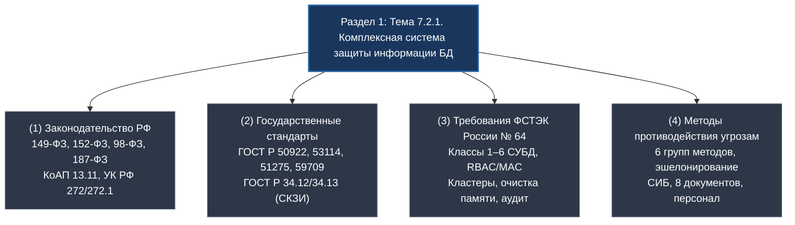
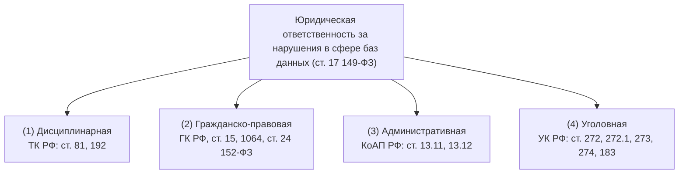
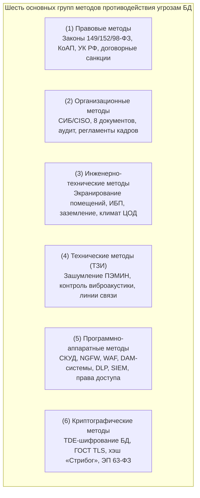
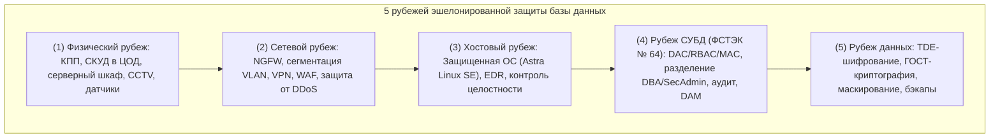

# 📚 МДК 07.02: ФСТЭК № 64, ГОСТы и методы противодействия (16.10.2026)
**Преподаватель:** Щербакова М.А. · **Пара:** Пт-4 (каб. 422)

### 16.10.26 — Раздел 1: Тема 7.2.1 (Тема 2.1). Защита и сохранность информации БД (Законодательство РФ, ГОСТы, ФСТЭК № 64, методы противодействия угрозам)
**Предмет:** [[📚 МДК 07.02 Сертификация ИС]] · **Преподаватель:** Щербакова М.А. · **Пара:** Пт-4 · **Ауд:** 422 / СДО  
**Тема по КТП:** Раздел 1: Тема 7.2.1 (Тема 2.1). Защита и сохранность информации баз данных. Комплексная система обеспечения безопасности БД (Законодательство РФ, ГОСТы, Требования ФСТЭК России № 64, Методы противодействия угрозам)  
Связи: [[📖 4 курс 1 сем]] · [[📖 Глоссарий 4 курс#📜 МДК 07.02 — Сертификация ИС|Глоссарий]] · [[✅ Сессия 4-1]] · [[📁 Материалы/МДК 07.02/Основные группы методов противодействия угрозам безопасности.pdf|Презентация СДО (PDF)]] · [[📁 Материалы/МДК 07.02/Макет титульного листа ПЗ_ЛР.docx|Макет отчёта (DOCX)]]

> [!abstract] Резюме комплексного блока Раздела 1 (TL;DR)
> - **Раздел 1: Тема 7.2.1** формирует целостную систему нормативно-технической защиты баз данных в Российской Федерации, опирающуюся на четыре неразрывных столпа:
>   1. **Законодательство РФ:** Конституция РФ (ст. 23, 24), базовый закон **№ 149-ФЗ** (ст. 16 — 6 обязанностей обладателя информации и оператора + **локализация баз данных граждан РФ** по ч. 7; ст. 17 — 4 вида ответственности), **№ 152-ФЗ** (уровни защищенности УЗ 1–4 по ПП РФ № 1119), **№ 98-ФЗ** (режим коммерческой тайны), **№ 187-ФЗ** (безопасность КИИ). Санкции радикально усилены: оборотные штрафы **1–3% годовой выручки** (до 500 млн руб.) по ст. 13.11 КоАП РФ и **до 10 лет лишения свободы** по новой **ст. 272.1 УК РФ** за незаконный оборот баз данных.
>   2. **Государственные стандарты (ГОСТы):** **ГОСТ Р 50922-2006** (фундаментальные понятия ТЗИ, физической защиты, защиты от НСД и утечки), **ГОСТ Р 53114-2008** (информационные активы, угрозы, уязвимости и риски), **ГОСТ Р 51275-2006** (классификация дестабилизирующих факторов), **ГОСТ Р 59709-2022** (уровни доверия УД 1–6 к ПО СУБД), **ГОСТ Р 34.12-2015** (отечественные криптографические шифры «Кузнечик» 128 бит и «Магма» 64 бит).
>   3. **Приказ ФСТЭК России от 14.04.2023 № 64:** специальный профильный норматив по безопасности СУБД. Вводит **6 классов защиты СУБД**; категорическое разделение обязанностей **Администратора СУБД (DBA)** и **Администратора безопасности (Security Admin)**; модели разграничения доступа DAC, RBAC и MAC (Row-Level Security); независимый аудит событий (`DDL`/`DML`); резервное копирование и обязательную эксплуатацию в **отказоустойчивом кластере** (High Availability) с автоматической синхронизацией для 4-го класса; гарантированную очистку оперативной памяти и дисков от остаточных данных; метрики производительности (TPS, QPS, Latency). Сертифицированные решения: *Postgres Pro Certified*, *Jatoba*, *Ред База Данных*, *Tantor*.
>   4. **Методы противодействия угрозам безопасности БД:** классификация на **шесть основных групп** (Правовые, Организационные, Инженерно-технические, Технические/ТЗИ, Программно-аппаратные, Криптографические) + Физические барьеры. Принцип **эшелонированной защиты (Defense-in-Depth)** в 5 рубежей. Регламенты Службы ИБ (**СИБ во главе с CISO**), обязательный минимум из **8 внутренних документов**, 3 фазы жизненного цикла персонала.

---

#### 🏛️ Блок I. Законодательство Российской Федерации в сфере ИБ и баз данных

Нормативно-правовая база РФ устанавливает императивные требования к хранению, обработке и защите данных в информационных системах и базах данных.

##### 1. Ключевые федеральные законы
| Закон | Предмет правового регулирования | Ключевые требования к базам данных |
|---|---|---|
| **ФЗ № 149-ФЗ** «Об информации, ИТ и о защите информации» | Базовый рамочный закон информационной сферы РФ | Триада свойств (КИД). Ст. 16: 6 обязательных обязанностей обладателя/оператора ИС; **ч. 7 ст. 16: обязательное размещение баз данных на территории РФ (локализация)**. Ст. 17: 4 вида ответственности. |
| **ФЗ № 152-ФЗ** «О персональных данных» | Защита прав субъектов при обработке их персональных данных (ПДн) | Обязательное получение согласия; категорирование ПДн (общие, специальные, биометрические, общедоступные); **уровни защищенности (УЗ 1–4)** по ПП РФ № 1119; уведомление Роскомнадзора об инцидентах в течение 24 часов. |
| **ФЗ № 98-ФЗ** «О коммерческой тайне» | Конфиденциальность сведений, имеющих действительную коммерческую ценность | Заявительный порядок: гриф секретности, поимённый учёт допущенных лиц, соглашения о неразглашении (NDA), регламенты допуска к серверам БД. |
| **ФЗ № 187-ФЗ** «О безопасности КИИ РФ» | Защита критической информационной инфраструктуры государства | Категорирование объектов КИИ (1–3 категории); подключение к ГосСОПКА / НКЦКИ; запрет использования иностранного софта на значимых объектах КИИ. |
| **ФЗ № 63-ФЗ** «Об электронной подписи» | Юридическая сила электронных документов и подтверждение авторства | Простая (ПЭП), усиленная неквалифицированная (УНЭП) и квалифицированная (УКЭП). Применение УКЭП для верификации целостности резервных копий и транзакций БД. |

##### 2. Обязанности обладателя информации и оператора ИС (ст. 16 ч. 4 ФЗ № 149-ФЗ)
Закон возлагает на оператора базы данных шесть непреложных обязанностей:
1. **Предотвращение несанкционированного доступа (НСД)** к информации и передачи ее лицам, не имеющим права на доступ (разграничение доступа DAC/RBAC).
2. **Своевременное обнаружение фактов НСД** к информации (системы мониторинга, SIEM, Database Activity Monitoring).
3. **Предупреждение возможности неблагоприятных последствий** нарушения порядка доступа к информации (сегментация сетей, изоляция СУБД).
4. **Недопущение воздействия на технические средства обработки информации**, в результате которого нарушается их функционирование (защита серверного оборудования ЦОД, ИБП).
5. **Возможность незамедлительного восстановления информации**, модифицированной или уничтоженной вследствие НСД (регулярные бэкапы, репликация, Disaster Recovery Plan).
6. **Постоянный контроль за обеспечением уровня защищенности информации** (периодический аудит ИБ, сканирование уязвимостей, пентесты).

##### 3. Уровни защищенности персональных данных в СУБД (ПП РФ № 1119)
Определение требуемого уровня защищенности (**УЗ 1, 2, 3 или 4**) осуществляется по комбинации 4 факторов:
- **Категория обрабатываемых данных:** специальные (здоровье, судимость, биометрия), биометрические, общедоступные, иные (стандартные ПДн).
- **Тип субъектов:** сотрудники организации или внешние граждане (клиенты, пользователи сервиса).
- **Объём базы данных:** менее 100 000 субъектов или более 100 000 субъектов.
- **Тип актуальных угроз:**
  - *1-й тип:* угрозы, связанные с наличием недокументированных возможностей (**НДВ**) в системном программном обеспечении (ОС СУБД).
  - *2-й тип:* угрозы, связанные с наличием НДВ в прикладном ПО (в самой СУБД).
  - *3-й тип:* угрозы, не связанные с НДВ (ошибки конфигурации, слабые пароли, инсайдеры).

##### 4. Система четырёх видов юридической ответственности (ст. 17 149-ФЗ)

- **(1) Дисциплинарная ответственность:** ст. 81 (п. «в» ч. 6), ст. 192 ТК РФ — замечание, выговор, **увольнение «по статье»** администратора или сотрудника за разглашение персональных данных или коммерческой тайны.
- **(2) Гражданско-правовая ответственность:** возмещение реального ущерба и упущенной выгоды (ст. 15, 1064 ГК РФ), штрафные неустойки по SLA, обязательная **компенсация морального вреда** гражданам за утечку их личных данных (ст. 24 ФЗ № 152-ФЗ).
- **(3) Административная ответственность (КоАП РФ):**
  - **Ст. 13.11 КоАП РФ:** дифференцированные штрафы до 15 млн руб. за факт первичной утечки.
  - **Федеральный закон № 420-ФЗ:** введение **оборотных штрафов от 1% до 3% совокупной годовой выручки компании** (в диапазоне от 20 млн до 500 млн руб.) за повторные инциденты утечек персональных данных.
  - **Ст. 13.12 КоАП РФ:** штрафы и конфискация несертифицированных средств защиты информации.
- **(4) Уголовная ответственность (УК РФ):**
  - **Ст. 272 УК РФ:** неправомерный доступ к компьютерной информации (до 7 лет лишения свободы).
  - **Новая ст. 272.1 УК РФ:** незаконные сбор, хранение, использование и передача баз данных компьютерной информации, содержащей персональные данные (до **10 лет лишения свободы** с многомиллионными штрафами при совершении из корыстной заинтересованности или организованной группой).
  - **Ст. 273 УК РФ:** создание, использование и распространение вредоносных программ (до 7 лет).
  - **Ст. 274 / 274.1 УК РФ:** нарушение правил эксплуатации средств хранения и обработки данных / КИИ РФ (до 10 лет).
  - **Ст. 183 УК РФ:** незаконное получение и разглашение сведений, составляющих коммерческую или банковскую тайну (до 7 лет).

---

#### 📐 Блок II. Государственные стандарты (ГОСТы) в области защиты информации БД

Государственные стандарты определяют строгий понятийный аппарат, классификационные модели и методы оценки надежности СУБД:

| ГОСТ | Название стандарта | Роль в обеспечении безопасности баз данных |
|---|---|---|
| **ГОСТ Р 50922-2006** | «Защита информации. Основные термины и определения» | Базовый терминологический фундамент. Определяет понятия **ТЗИ**, **физической защиты**, **защиты от НСД**, **утечки информации**, **разглашения** и **безопасности информации**. |
| **ГОСТ Р 53114-2008** | «Защита информации. Обеспечение информационной безопасности в организации. Основные термины и определения» | Описывает модель управления ИБ: **информационные активы** (таблицы, индексы, схемы БД), **угрозы**, **уязвимости**, оценку рисков и менеджмент инцидентов. |
| **ГОСТ Р 51275-2006** | «Защита информации. Объект информатизации. Факторы, воздействующие на информацию. Общие положения» | Классифицирует дестабилизирующие воздействия на СУБД: **антропогенные** (ошибки DBA, инсайдеры, хакеры), **техногенные** (отказы дисков RAID, сбои питания) и **стихийные** (пожары, затопления серверной). |
| **ГОСТ Р 59709-2022** | «Требования к оценке безопасности программного обеспечения» | Методология сертификации СУБД на отсутствие недекларированных возможностей (НДВ), статический и динамический анализ исходного кода движка СУБД, фаззинг-тестирование. |
| **ГОСТ Р 34.12-2015 / 34.13-2015** | «Криптографическая защита информации. Блочные шифры» | Обязательные российские алгоритмы симметричного шифрования для СУБД: шифр **«Кузнечик»** (размер блока 128 бит, ключ 256 бит) и шифр **«Магма»** (размер блока 64 бит, ключ 256 бит). Используются в прозрачном шифровании БД (TDE). |
| **ГОСТ Р 34.10-2012 / 34.11-2012** | «Электронная цифровая подпись» и «Функция хэширования» | Хеш-функция **«Стрибог»** (256/512 бит) для контроля неизменности таблиц и верификации контрольных сумм резервных копий СУБД. |

##### Базовые нормативные определения (ГОСТ Р 50922-2006):
- **Техническая защита информации (ТЗИ):** защита информации, заключающаяся в обеспечении некриптографическими методами безопасности информации (данных), подлежащей защите в соответствии с законодательством, с применением технических, программных и программно-технических средств.
- **Физическая защита информации:** предотвращение доступа посторонних лиц на охраняемую территорию и в помещения с серверами баз данных с помощью инженерных конструкций, турникетов, замков и постов охраны.
- **Защита от НСД:** комплекс мер, исключающий доступ к таблицам, процедурам и конфигурациям базы данных субъектов, не обладающих установленными правами.
- **Утечка информации:** неконтролируемый выход конфиденциальных сведений за пределы информационной системы или контролируемой зоны (включая технические каналы утечки и цифровые сливы).

---

#### 🛡️ Блок III. Требования по безопасности информации к СУБД (Приказ ФСТЭК России № 64)

**Приказ ФСТЭК России от 14 апреля 2023 г. № 64** утвердил официальные *«Требования по безопасности информации к системам управления базами данных»*. Это ключевой технический регламент сертификации СУБД на российском рынке.

##### 1. Классы защиты СУБД и матрица применимости
Стандарт устанавливает **шесть классов защиты СУБД**: самый жесткий — **1-й класс**, базовый для открытых систем — **6-й класс**:

| Класс СУБД | Государственные ИС (Приказ № 17 / № 117) | Персональные данные (ПП РФ № 1119 / Приказ № 21) | Объекты КИИ (ФЗ № 187-ФЗ) | Автоматизированные системы (АС) |
|---|---|---|---|---|
| **Класс 1** | — | — | — | АС класса 1А (Особая важность, Гостайна «ОВ») |
| **Класс 2** | — | — | — | АС класса 1Б (Совершенно секретно «СС») |
| **Класс 3** | — | — | — | АС класса 1В (Секретно «С») |
| **Класс 4** | **ГИС 1-го класса защищенности (К1)** | **ИСПДн 1-го уровня защищенности (УЗ-1)** | **Значимые объекты КИИ 1-й категории** | АС класса 1Г, 2А, 3А (Конфиденциально) |
| **Класс 5** | ГИС 2-го класса защищенности (К2) | ИСПДн 2-го уровня защищенности (УЗ-2) | Значимые объекты КИИ 2-й категории | АС класса 1Д, 2Б, 3Б |
| **Класс 6** | ГИС 3-го класса защищенности (К3) | ИСПДн 3-го и 4-го уровней (УЗ-3, УЗ-4) | Значимые объекты КИИ 3-й категории | Открытые корпоративные ИС |

##### 2. Разделение обязанностей и ролевая модель безопасности
Приказ ФСТЭК № 64 категорически запрещает концентрацию всех полномочий в руках одного администратора. СУБД обязана аппаратно или программно разделять две роли:
- **Администратор СУБД (DBA):** отвечает за эксплуатацию, производительность, структуру (`DDL`), оптимизацию индексов и выполнение резервного копирования. **DBA не имеет права изменять политики безопасности и просматривать конфиденциальные пользовательские данные.**
- **Администратор безопасности (Security Admin):** управляет учетными записями, назначает права и роли, конфигурирует аудит и анализирует журналы безопасности. **Администратор безопасности не вмешивается в прикладную логику таблиц.**
- **Защита от всемогущего суперпользователя (`root`/`postgres`):** исключение возможности отключения аудита или удаления записей в журналах лицом, обладающим максимальными системными привилегиями.

##### 3. Модели управления доступом к данным
1. **Дискреционный доступ (DAC — Discretionary Access Control):**
   - Управление на основе списков прав доступа (`ACL`).
   - Операторы SQL: `GRANT` (выдача прав на `SELECT`, `INSERT`, `UPDATE`, `DELETE`, `EXECUTE`) и `REVOKE` (отзыв прав).
   - Применяется в СУБД классов 6, 5 и 4.
2. **Ролевой доступ (RBAC — Role-Based Access Control):**
   - Назначение прав не конкретным лицам, а служебным ролям (`CREATE ROLE financial_auditor`).
   - Пользователь получает доступ только в рамках активной роли в сессии.
3. **Мандатный доступ (MAC — Mandatory Access Control / MLS):**
   - Требуется для классов 1–3, а также реализуется в сертифицированных расширениях СУБД 4-го класса.
   - Каждой строке или столбцу таблицы присваивается классификационная метка («Неконфиденциально», «ДСП», «Секретно»).
   - Субъект может прочесть данные только при совпадении или превышении своего мандатного уровня допуска (правила Белла-Лападулы: *no read up, no write down*).
   - Технология **Row-Level Security (RLS)** в защищенных реляционных базах.

##### 4. Журналирование и аудит событий безопасности
СУБД обязана вести независимый, защищенный от модификации журнал аудита, в котором безусловно фиксируются:
- Все факты аутентификации пользователей и попытки входа (как успешные, так и неуспешные с фиксацией IP-адреса и времени).
- Любые изменения прав доступа, ролей и политик безопасности.
- Операции модификации структуры данных (`DDL`: `CREATE TABLE`, `ALTER TABLE`, `DROP`, `TRUNCATE`).
- Факты доступа к конфиденциальным таблицам (`SELECT`) и попытки несанкционированного чтения.
- Срабатывание механизмов блокировки учетных записей при переборе паролей (Brute-Force).

##### 5. Резервное копирование и отказоустойчивые кластеры (High Availability)
- Для 5-го и 6-го классов: регулярное резервное копирование данных, схем и атрибутов безопасности (самостоятельно или внешними сертифицированными бэкап-системами).
- **Для 4-го класса (специальное жесткое требование):**
  - Обязательное резервирование параметров конфигурации самой СУБД.
  - **Обязательное функционирование в составе отказоустойчивого кластера** с одновременной работой нескольких узлов СУБД (High Availability).
  - Автоматическая репликация данных и мгновенное переключение нагрузки при падении основного узла (Failover) без потери транзакций (`RPO = 0`, минимальный `RTO`).

##### 6. Гарантированная очистка оперативной памяти и дисков
Приказ № 64 предписывает обязательную очистку памяти (зануление/затирание псевдослучайными последовательностями):
- Оперативная память (буферы обмена, кэш страниц, временные переменные) должна очищаться перед повторным выделением другому процессу.
- Освобожденные блоки на дисковых накопителях (при выполнении `DROP TABLE` или `DELETE`) подлежат физической очистке для предотвращения восстановления конфиденциальных данных forensic-утилитами.

##### 7. Метрики производительности СУБД при активной защите
Включение механизмов безопасности не должно приводить к отказу в обслуживании. СУБД обязана обеспечивать измеримые параметры:
- **QPS (Queries Per Second):** количество обрабатываемых запросов в секунду.
- **TPS (Transactions Per Second):** количество завершенных транзакций в секунду в соответствии с критериями ACID.
- **Latency / Response Time:** максимальное время задержки ответа на транзакцию.

##### 8. Реестр отечественных сертифицированных СУБД
| СУБД | Разработчик | Класс ФСТЭК / УД | Особенности архитектуры |
|---|---|---|---|
| **Postgres Pro Certified** | Postgres Professional | Класс 4 / УД 4 | Флагман рынка РФ. Встроенный модуль `pg_proaudit`, мандатный доступ, очистка RAM, поддержка мультимастер-кластеров. Для ГИС 1, УЗ-1, КИИ 1. |
| **Jatoba** | Газинформсервис | Класс 4 / УД 4 | Высокопроизводительная СУБД на ядре PostgreSQL с глубоким контролем соединений и защитой объектов КИИ. |
| **Ред База Данных** | РЕД СОФТ | Класс 4 / УД 4 | Промышленная СУБД на ядре Firebird, оптимизирована для экосистемы РЕД ОС. |
| **Tantor** | ГК «Астра» | Класс 4 / УД 4 | СУБД со специальной графической платформой мониторинга и администрирования баз данных. |
| **Linter-ВС (Бастион)** | РЕЛЭКС | Класс 2 / УД 2 | Полностью оригинальное российское ядро (без открытого кода). Сертифицирована для сведений особой важности. |

---

#### ⚔️ Блок IV. Методы противодействия угрозам безопасности информации БД

Согласно Банку данных угроз (БДУ) ФСТЭК России, базы данных подвержены **более 227 разновидностям атак** (SQL-инъекции, несанкционированное чтение дампов памяти, перехват протокола репликации, сговор администраторов, атаки типа «отказ в обслуживании» на пул соединений).

Противодействие этим угрозам осуществляется шестью группами взаимодополняющих методов:

##### 1. Шесть групп методов противодействия угрозам
1. **Правовые методы:**
   - Формируют правовую основу и ответственность: Конституция РФ, 149-ФЗ, 152-ФЗ, 98-ФЗ, 187-ФЗ.
   - Договорные обязательства с персоналом (NDA) и контрагентами (соглашения о конфиденциальности и уровни обслуживания SLA).
   - Неотвратимость наказания по ст. 13.11 КоАП РФ (оборотные штрафы) и ст. 272.1 УК РФ.
2. **Организационные методы:**
   - Регламентация процессов обработки информации и эксплуатации СУБД.
   - Создание специализированного подразделения — **Службы информационной безопасности (СИБ во главе с CISO)**, подчиняющейся первому лицу организации.
   - Разработка и утверждение **обязательного пакета из 8 внутренних документов ИБ**:
     1) Политика информационной безопасности организации.
     2) Приказ о назначении ответственного за организацию обработки ПДн.
     3) Регламент разграничения прав доступа к СУБД и ИС.
     4) Инструкция пользователя и администратора БД по обеспечению ИБ.
     5) Модель угроз и нарушителя безопасности информации.
     6) Положение о коммерческой тайне с перечнем защищаемых сведений.
     7) План реагирования на инциденты информационной безопасности.
     8) Журналы учёта носителей информации, резервных копий и проверок.
   - **Регламент кадровой безопасности по трем фазам жизненного цикла:**
     - *Приём:* проверка кандидатов СБ, подписание обязательства о неразглашении (NDA).
     - *Штат:* обязательные инструктажи не реже 1 раза в квартал, фишинг-симуляции, мониторинг аномальной активности.
     - *Увольнение:* мгновенный отзыв прав доступа и учетных записей до покидания рабочего места, возврат токенов и техники, письменное напоминание об ответственности за разглашение тайны на срок до 3–5 лет.
   - **Организационно-правовой режим коммерческой тайны (98-ФЗ):** обязательное нанесение грифа «Коммерческая тайна», ограничение доступа, поимённый учет допущенных лиц.
3. **Инженерно-технические методы:**
   - Защита физической среды размещения серверов СУБД и СХД.
   - Строительное и конструктивное экранирование серверных комнат (капсулы ЦОД) для подавления побочных электромагнитных излучений и наводок (**ПЭМИН**).
   - Системы гарантированного и бесперебойного электропитания (промышленные ИБП, дизель-генераторные установки ДГУ).
   - Прецизионное кондиционирование, автоматическое газовое пожаротушение, датчики протечки воды.
4. **Технические методы (ТЗИ):**
   - Некриптографическое подавление технических каналов утечки данных.
   - Применение сертифицированных генераторов пространственного электромагнитного шума по цепям питания и заземления.
   - Виброакустическая защита (генераторы помех на оконных стеклах и вентиляционных коробах серверных).
   - Волоконно-оптические выделенные линии передачи трафика репликации БД, не излучающие радиосигнал.
5. **Программно-аппаратные методы:**
   - **СКУД (Система контроля и управления доступом):** биометрический доступ и смарт-карты в серверные стойки.
   - **Межсетевые экраны нового поколения (NGFW):** фильтрация сетевого периметра и изоляция сегмента БД.
   - **Web Application Firewall (WAF):** перехват и фильтрация веб-запросов к базам данных (защита от SQL-инъекций на внешнем рубеже).
   - **Database Activity Monitoring (DAM):** мониторинг всех транзакций к СУБД в реальном времени независимым сетевым сенсором.
   - **DLP-системы (Data Loss Prevention):** контроль выгрузок, экспорта таблиц и пересылки дампов БД через почту, мессенджеры и USB.
   - **SIEM-системы (Security Information and Event Management):** сбор и автоматическая корреляция сотен тысяч логов в секунду, выявление несанкционированных ночных дампов БД.
6. **Криптографические методы:**
   - Использование сертифицированных СКЗИ по ГОСТ Р 34.12-2015 («Кузнечик», «Магма»).
   - **TDE (Transparent Data Encryption):** шифрование табличных пространств, файлов данных и журналов транзакций на уровне хранилища СУБД.
   - Защита сетевых сессий клиент-СУБД и репликации между узлами кластера по протоколам TLS с ГОСТ-шифрованием.
   - Хеширование паролей пользователей (с использованием криптографической соли).
   - Электронная подпись (63-ФЗ) для подтверждения авторства и целостности резервных копий.

##### 2. Принцип эшелонированной защиты базы данных (Defense-in-Depth)
Безопасность СУБД строится по принципу последовательных рубежей обороны:

##### 3. Комплексная матрица «Угроза БД → Метод противодействия → Конкретное средство»
| Угроза безопасности БД | Вектор атаки | Применяемый метод | Конкретное сертифицированное средство / Решение |
|---|---|---|---|
| **SQL Injection (SQLi)** | Внедрение вредоносного SQL-кода через веб-формы приложений | Программно-аппаратный | Web Application Firewall (**PT Application Firewall**, SolidWall), параметризованные SQL-запросы |
| **Утечка дампа через инсайдера (DBA)** | Выгрузка базы данных на съемный диск или через сетевой канал | Организационный + Программно-аппаратный | **DLP-системы** (InfoWatch Traffic Monitor, Solar Dozor, SearchInform КИБ), разделение ролей DBA / Admin ИБ |
| **Перехват трафика репликации БД** | Снятие копий сетевых пакетов между мастером и репликой | Криптографический + Технический | СКЗИ **«Континент 4»**, **ViPNet Coordinator**, шифрование сессий ГОСТ TLS |
| **Кража физических дисков из сервера** | Прямое изъятие накопителей из серверной стойки ЦОД | Инженерный + Криптографический | **TDE-шифрование** («Кузнечик»/«Магма»), СКУД в ЦОД, датчики вскрытия серверов |
| **Перебор учетных записей (Brute-Force)** | Автоматизированный подбор паролей к портам СУБД | Программно-аппаратный (ФСТЭК № 64) | Блокировка УЗ после 3–5 неудачных попыток, двухфакторная аутентификация (**2FA/MFA**) |
| **Утечка через побочные излучения** | Перехват информации по каналу ПЭМИН | Инженерно-технический + ТЗИ | Генераторы шума **«Гром-И-4»**, экранированные серверные шкафы |
| **Сбой дискового массива / порча данных** | Техногенный сбой оборудования | Технический (Отказоустойчивость) | **Отказоустойчивый кластер (High Availability)**, синхронная репликация, бэкапы Кибер Бэкап |

---

#### 📋 Блок V. Сквозной контрольный чек-лист соответствия СУБД требованиям Раздела 1

Чек-лист готовности базы данных к практическим работам, аттестации ИС и зачёту:

| № | Контрольный критерий | Нормативное требование | Статус проверки |
|---|---|---|---|
| 1 | **Локализация базы данных** | Серверы СУБД физически размещены на территории РФ (ст. 16 ч. 7 ФЗ № 149-ФЗ) | [ ] Проверено |
| 2 | **Сертификат ФСТЭК России** | СУБД сертифицирована по Приказу № 64 (не ниже требуемого класса 4/5/6) | [ ] Проверено |
| 3 | **Разделение полномочий** | Учетные записи DBA и Администратора безопасности разделены; суперпользователь изолирован | [ ] Проверено |
| 4 | **Матрица доступа (RBAC/DAC)** | Доступ ко всем таблицам ограничен минимально необходимыми ролями | [ ] Проверено |
| 5 | **Журналирование и аудит** | Включен аудит событий безопасности (`DDL`, входы, ошибки, доступ к конфиденциальным таблицам) | [ ] Проверено |
| 6 | **Отказоустойчивость и кластеризация** | Настроена репликация и план автоматического аварийного восстановления (HA) | [ ] Проверено |
| 7 | **Резервное копирование** | Автоматизированные бэкапы со снятием конфигурации СУБД и контролем целостности по ГОСТ | [ ] Проверено |
| 8 | **Очистка памяти и дисков** | Настроена очистка оперативной памяти и затирание освобождаемых дисковых секторов | [ ] Проверено |
| 9 | **Пакет ЛНА предприятия** | Утверждены 8 обязательных документов ИБ, назначены ответственные лица, подписаны NDA | [ ] Проверено |
| 10 | **Сетевая изоляция СУБД** | Порты СУБД закрыты от прямого доступа извне; трафик фильтруется через NGFW / WAF | [ ] Проверено |

---

#### 📚 Рекомендованная нормативная литература и источники

1. **Федеральное законодательство Российской Федерации:**
   - Федеральный закон от 27.07.2006 № 149-ФЗ «Об информации, информационных технологиях и о защите информации».
   - Федеральный закон от 27.07.2006 № 152-ФЗ «О персональных данных».
   - Федеральный закон от 29.07.2004 № 98-ФЗ «О коммерческой тайне».
   - Федеральный закон от 26.07.2017 № 187-ФЗ «О безопасности критической информационной инфраструктуры РФ».
   - Федеральный закон от 06.04.2011 № 63-ФЗ «Об электронной подписи».
   - Кодекс Российской Федерации об административных правонарушениях (ст. 13.11, 13.12).
   - Уголовный кодекс Российской Федерации (ст. 272, 272.1, 273, 274, 183).
2. **Нормативные правовые акты ведомств и стандарты:**
   - **Приказ ФСТЭК России от 14.04.2023 № 64** «Об утверждении Требований по безопасности информации к системам управления базами данных».
   - **Постановление Правительства РФ от 01.11.2012 № 1119** «Об утверждении требований к защите персональных данных при их обработке в информационных системах персональных данных».
   - **Приказ ФСТЭК России от 18.02.2013 № 21** (состав мер защиты ПДн).
   - **ГОСТ Р 50922-2006** «Защита информации. Основные термины и определения».
   - **ГОСТ Р 53114-2008** «Защита информации. Обеспечение информационной безопасности в организации. Основные термины и определения».
   - **ГОСТ Р 51275-2006** «Факторы, воздействующие на информацию. Общие положения».
   - **ГОСТ Р 59709-2022** «Требования к оценке безопасности программного обеспечения».
   - **ГОСТ Р 34.12-2015** «Криптографическая защита информации. Блочные шифры».
3. **Учебные издания и материалы СДО Moodle:**
   - *Презентация курса СДО АИТУ:* [[📁 Материалы/МДК 07.02/Основные группы методов противодействия угрозам безопасности.pdf|Основные группы методов противодействия угрозам безопасности.pdf]].
   - *Голицына О.Л., Максимов Н.В., Попов И.И.* «Информационные системы». — 2-е изд. — М.: Форум: НИЦ ИНФРА-М, 2022. — 448 с.
   - *Нестеров С.А.* «Базы данных: учебник и практикум для СПО». — М.: Юрайт, 2020. — 230 с.

---
