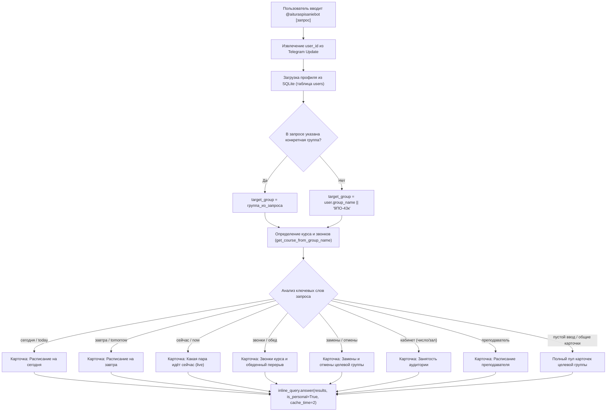
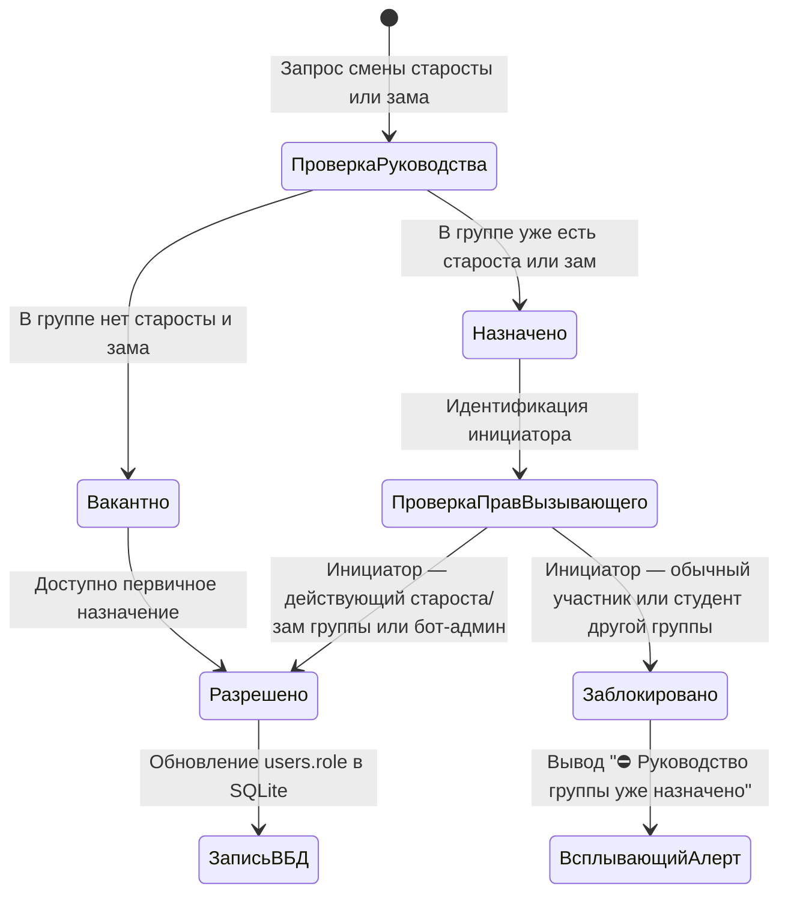
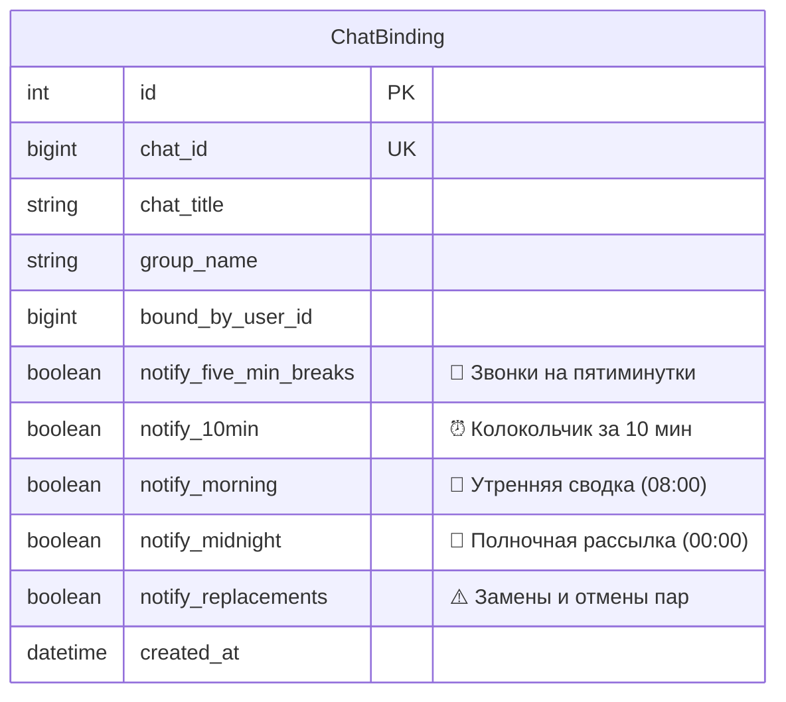

# 📖 Архитектура инлайн-режима, управления ролями и системы уведомлений бесед

## 1. Обзор архитектурных обновлений

В рамках обновления системы реализованы три ключевых функциональных направления:
1. **Инлайн-режим (`@aituraspisaniebot [запрос]`)**: устранён хардкод группы `9ПО-43к`. Реализован динамический контекстный резолвинг академической группы вызывающего пользователя или группы из поискового запроса, быстрая выдача карточек (сегодня, завтра, текущий статус, неделя, звонки курса с расписанием обеда, замены) и персональное кэширование (`is_personal=True`).
2. **Персистентность и ролевая безопасность (Access Control)**: хранение руководящих статусов (`starosta`, `zam_starosty`) в реляционной таблице `users` SQLite, строгая защита от несанкционированной смены руководства посторонними участниками, синхронизация с Mini App через REST API `/api/profile`.
3. **Гибкое управление оповещениями бесед (`/chat_settings`)**: хранение индивидуальных флагов уведомлений в модели `ChatBinding` с интерактивной инлайн-клавиатурой тумблеров.

---

## 2. Инлайн-режим (Inline Query Engine)

### Доступные инлайн-карточки

| Тип карточки | Триггер запроса | Содержимое |
|---|---|---|
| **📅 Сегодня** | `@bot`, `@bot сегодня`, `@bot <группа>` | Асинхронно форматированное расписание дня с учётом чётности и активных замен. |
| **🔜 Завтра** | `@bot`, `@bot завтра`, `@bot <группа>` | Расписание следующего учебного дня с автоматическим сдвигом дней. |
| **⚡️ Текущий статус** | `@bot`, `@bot сейчас`, `@bot пара` | Текущий урок, номер пары, кабинет, преподаватель, шкала прогресса и оставшиеся минуты. |
| **🗓 Вся неделя** | `@bot`, `@bot неделя`, `@bot <группа>` | Сводное расписание с понедельника по субботу целевой группы. |
| **🔔 Звонки и обеды** | `@bot`, `@bot звонки`, `@bot обед` | Дифференцированный график пар и персональный обед для курса целевой группы. |
| **⚠️ Замены и отмены** | `@bot`, `@bot замены`, `@bot отмены` | Официальные изменения учебной части из базы данных. |
| **📍 Аудитория** | `@bot 304`, `@bot 515`, `@bot с/з` | Дни и пары, проходящие в указанном кабинете. |
| **👨‍🏫 Преподаватель** | `@bot <фамилия>` | Live-поиск занятости преподавателя по всем 57 группам колледжа. |

---

## 3. Модель разграничения прав руководства группы (Access Control)

### Матрица полномочий старостата

| Роль пользователя | Первичное назначение | Смена старосты | Смена заместителя | Снятие руководства |
|---|:---:|:---:|:---:|:---:|
| **👑 Администратор бота** | ✅ Разрешено | ✅ Разрешено | ✅ Разрешено | ✅ Разрешено |
| **⭐️ Действующий староста** | ✅ Разрешено | ✅ Разрешено | ✅ Разрешено | ✅ Разрешено |
| **🎗 Действующий зам** | ✅ Разрешено | ✅ Разрешено | ✅ Разрешено | ✅ Разрешено |
| **🎓 Обычный студент группы** | ✅ (только если вакантно) | ❌ Заблокировано | ❌ Заблокировано | ❌ Заблокировано |
| **👤 Пользователь другой группы** | ❌ Заблокировано | ❌ Заблокировано | ❌ Заблокировано | ❌ Заблокировано |

### Защита от утечки прав при смене группы
При выполнении команды смены группы (`update_user_group(user_id, new_group)`) в случае, если пользователь имел роль `starosta` или `zam_starosty`, система автоматически выполняет сброс роли:
$$\text{role} \leftarrow \text{'student'}$$
Это исключает ситуацию, при которой экс-староста одной группы сохранял бы административные привилегии в новой академической группе.

---

## 4. Архитектура настроек уведомлений бесед (`ChatBinding`)

В реляционную модель `ChatBinding` интегрированы 5 независимых флагов системных оповещений:

### Спецификация тумблеров

| Колонка в БД | Название тумблера | Время срабатывания | Описание |
|---|---|---|---|
| `notify_five_min_breaks` | Звонки на пятиминутки | Внутри каждой пары (45 мин) | Системный колокольчик о 5-минутном перерыве или начале обеда. |
| `notify_10min` | Колокольчик за 10 мин | За 10 мин до начала пары | Напоминание студентам о начале занятия с указанием кабинета. |
| `notify_morning` | Утренняя сводка | 08:00 по будням | Общее расписание на день перед началом занятий. |
| `notify_midnight` | Полночная рассылка | 00:00 по будням | Детальное расписание на наступающий учебный день. |
| `notify_replacements` | Замены и отмены | Моментально при публикации | Экстренное оповещение группы об изменении расписания. |

### Управление тумблерами
- Команды вызова в беседах: `/chat_settings` или `/settings`.
- Права на изменение: администраторы Telegram-беседы, староста привязанной группы или администраторы бота.
- Формат колбэка: `toggle_chat_set_{chat_id}_{setting_key}`.
