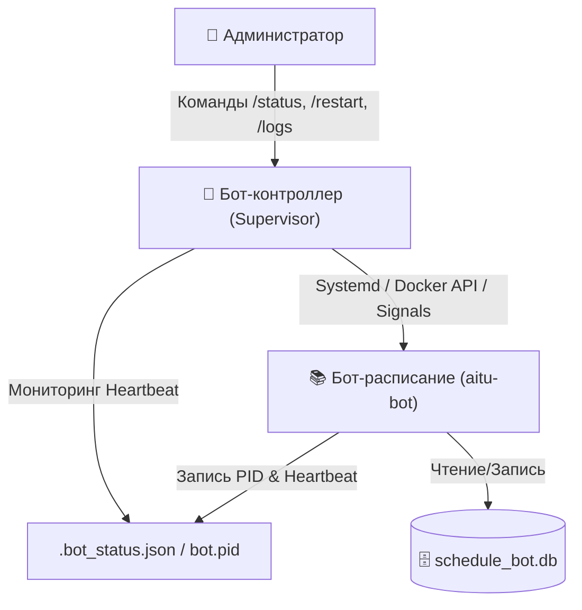

# 🚀 Руководство по переносу на личный VPS и архитектура бота-контроллера

Документ подготовлен в качестве фундамента для предстоящего переноса бота на собственный Linux VPS и подключения выделенного бота-контроллера (Supervisor/Watchdog).

---

## 1. Архитектура взаимодействия с ботом-контроллером

Для максимальной надёжности бот-расписание и бот-контроллер разделены на два независимых процесса:



### Способы управления ботом-расписанием из контроллера:
1. **Через Systemd (Рекомендуемый для чистого VPS):**
   * Контроллер выполняет асинхронные команды:
     * Перезапуск: `systemctl restart aitu-bot`
     * Статус: `systemctl status aitu-bot`
     * Логи: `journalctl -u aitu-bot -n 50 --no-pager`
   * Настройка sudoers без пароля для пользователя контроллера:
     ```bash
     aitu-controller ALL=(ALL) NOPASSWD: /bin/systemctl restart aitu-bot, /bin/systemctl status aitu-bot, /bin/journalctl
     ```

2. **Через Docker:**
   * Контроллер использует Docker SDK или команду `docker restart aitu-schedule-bot`.

3. **Через IPC / PID файл (`bot.pid` & `.bot_status.json`):**
   * Основной бот при запуске сохраняет свой PID в `bot.pid` и периодически обновляет статус (аптайм, память, статус задач APScheduler) в `.bot_status.json`.
   * Контроллер в реальном времени видит, "жив" ли процесс, и если бот завис, может послать `SIGTERM` / `SIGKILL` и запустить заново.

---

## 2. Пошаговый чек-лист переноса на VPS

### Шаг 1. Подготовка сервера (Ubuntu 22.04 / 24.04 LTS)
```bash
sudo apt update && sudo apt upgrade -y
sudo apt install -y python3.12 python3.12-venv python3-pip git curl htop
```

### Шаг 2. Клонирование и установка зависимостей
```bash
cd /opt
sudo git clone https://github.com/wxrrry/aitu-schedule-bot.git
cd /opt/aitu-schedule-bot
python3.12 -m venv venv
source venv/bin/activate
pip install --upgrade pip
pip install -r requirements.txt
```

### Шаг 3. Настройка переменных окружения
```bash
cp .env.example .env
nano .env
# Заполняем BOT_TOKEN, ADMIN_IDS=1019252177,792569339 и остальные параметры
```

### Шаг 4. Регистрация Systemd службы
```bash
sudo cp deploy/aitu-bot.service /etc/systemd/system/
sudo systemctl daemon-reload
sudo systemctl enable aitu-bot
sudo systemctl start aitu-bot
sudo systemctl status aitu-bot
```

---

## 3. Встроенная поддержка в коде бота-расписания
В проект уже заложены:
- Генерация PID файла `bot.pid` и файла статуса `.bot_status.json`.
- Корректная обработка сигналов `SIGINT` и `SIGTERM` (Graceful Shutdown) для закрытия базы данных и остановки планировщика без потери данных.
- Healthcheck сервер на порту 8080.
